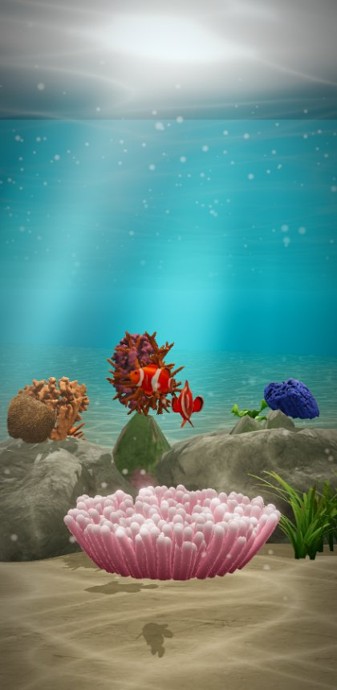
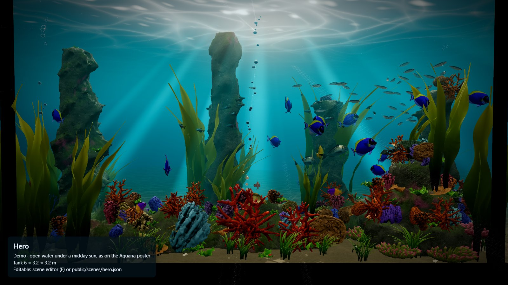
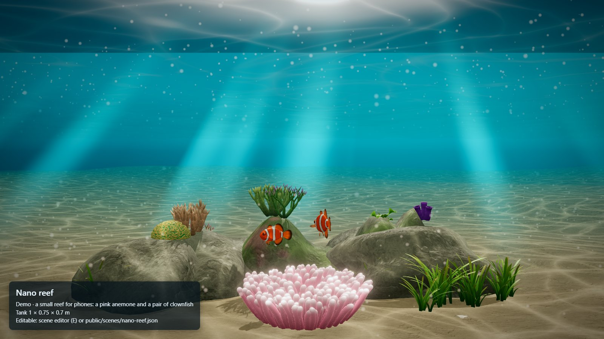

# Aquaria

<p align="center"><b>English</b> · <a href="README.it.md">Italiano</a></p>

[](https://nispa.github.io/Aquaria/)

<h3 align="center">▶ <a href="https://nispa.github.io/Aquaria/">Try it in your browser</a></h3>

<p align="center">Nothing to install: it runs in any recent browser, on a phone too.</p>

Aquaria is a 3D aquarium that runs in the browser. It was made for big
screens, from a Full HD monitor to a 4K LED wall, but it works on a laptop
too.

Each tank is a JSON file: the size of the tank, the water, the light, the
plants, the rocks and the fish. You can change it by hand or with the
built-in editor. The fish are not on rails: each one decides where to go,
swims in its species' own way, eats, hides, rests at night and reacts to you.

On a phone Aquaria opens a small reef of its own, light enough for the
phone to draw smoothly.


<sub>Aquaria, the show tank: sea and fresh water fish together, in the Hero look.</sub>


<sub>Press `A` to see what every fish is doing, and `C` for the shapes they swim around.</sub>

<p align="center">
  
  <br>
  <sub>On a phone: the Nano reef, an anemone and a pair of clownfish.</sub>
</p>

| [](docs/scenes/hero.jpg) | [](docs/scenes/aquaria.jpg) | [](docs/scenes/nano-reef.jpg) | [](docs/scenes/reef.jpg) | [](docs/scenes/home-reef.jpg) | [](docs/scenes/planted-tank.jpg) | [](docs/scenes/iwagumi.jpg) |
| :---------------------------------------------------: | :------------------------------------------------------------: | :------------------------------------------------------------------: | :------------------------------------------------------------: | :------------------------------------------------------------------: | :---------------------------------------------------------------------------: | :------------------------------------------------------------: |
|                         Hero                          |                            Aquaria                             |                              Nano reef                               |                         Tropical reef                          |                              Home reef                               |                                 Planted tank                                  |                            Iwagumi                             |

## Things to try

- Press `Space` to drop some food and watch the fish come up for it.
- Click the glass: the fish nearby dart off, some go and hide.
- Leave the mouse still on the tank: the curious ones come over to look.
- Draw quick circles near a fish to hypnotize it. Scribble over it to
  tickle it.
- Press `T` for a torch, `Z` for a magnifying glass, `A` to see what each
  fish is up to, `H` for the control panel.

Everything you can do with the fish is in
[Playing with the fish](docs/INTERACTION.md).

## Running it

You need Node.js 22 and pnpm.

```bash
pnpm install
pnpm dev          # then open the address it prints
```

The online version is published from `main` at
<https://nispa.github.io/Aquaria/>. It can be installed as an app (the
browser's _Install_ button) and then works offline.

### Keys

| Key               | What it does                                                   |
| ----------------- | -------------------------------------------------------------- |
| `H`               | Control panel                                                  |
| `F`               | Full screen                                                    |
| `Space`           | A pinch of food, above the mouse                               |
| `A`               | What every fish is doing                                       |
| `C` (with `A` on) | The shapes fish swim around                                    |
| `T`               | Torch                                                          |
| `Z`               | Magnifying glass                                               |
| `M`               | Sound on or off                                                |
| `P`               | On a touch screen, a touch points instead of tapping the glass |
| `E`               | Scene editor                                                   |

When you move the mouse or touch the screen, a few round buttons show up
in the corner (point, torch, magnifier, food, panel) and fade away again.

### Options in the address

| Option    | Example                  | What it does                                   |
| --------- | ------------------------ | ---------------------------------------------- |
| `scene`   | `?scene=home-reef`       | Opens that scene                               |
| `hour`    | `?hour=21.5`             | Fixes the time of day                          |
| `seed`    | `?seed=7`                | Another random layout of the same scene        |
| `effects` | `?effects=shadows,bloom` | Only these effects (`none` turns them all off) |
| `frozen`  | `?frozen=10`             | Runs 10 seconds, then shows a still picture    |
| `debug`   | `?debug=overlay,shapes`  | Starts with `A` (and `C`) on                   |

Whatever you change in the panel is remembered by the browser.

## The scenes

Seven scenes come with Aquaria. They are examples: open any of them in the
editor (`E`), change it and save it as your own. The panel (`H`) switches
scene and look.

| Scene                         | What it is                                         | Tank (w × h × d) |
| ----------------------------- | -------------------------------------------------- | ---------------- |
| Hero (`hero`, default)        | Open water: reef pillars, corals, kelp and schools | 6 × 3.2 × 3.2 m  |
| Aquaria (`aquaria`)           | A show tank, sea and fresh water mixed for the fun | 6 × 3.2 × 3.2 m  |
| Nano reef (`nano-reef`)       | A small reef with an anemone; phones open this one | 1 × 0.75 × 0.7 m |
| Tropical reef (`reef`)        | Open sea, a coral reef                             | 5.4 × 3 × 4 m    |
| Home reef (`home-reef`)       | A marine reef aquarium                             | 6 × 2.6 × 2.4 m  |
| Planted tank (`planted-tank`) | A freshwater tank with plants, shrimps and a crab  | 2.4 × 1.1 × 1 m  |
| Iwagumi (`iwagumi`)           | A freshwater aquascape of stones and carpet plants | 2.2 × 1.1 × 1 m  |

## On a wall

Build it once, serve it, and open it in Chrome in kiosk mode:

```bash
pnpm build
pnpm preview --host
chrome --kiosk --autoplay-policy=no-user-gesture-required http://localhost:4173
```

Turn off sleep and the screen saver on that computer. Start at 4K, then try
Full HD from where people will stand: if you cannot tell them apart, keep
the lower one. The GPU will thank you.

### Use the dedicated GPU

On a PC with two graphics cards, Windows often runs the browser on the
weaker, built-in one, and 4K will stutter. The panel shows which GPU is in
use under **Quality**, with a warning when it is the built-in one.

To move Chrome or Edge to the dedicated card:

1. Windows Settings → System → Display → **Graphics**. Add the browser if
   it is not in the list (Edge is
   `C:\Program Files (x86)\Microsoft\Edge\Application\msedge.exe`, Chrome
   `C:\Program Files\Google\Chrome\Application\chrome.exe`), then
   _Options_ → **High performance**. This setting wins over the NVIDIA and
   AMD control panels, which browsers often ignore.
2. Make sure hardware acceleration is on: `edge://settings/system` or
   `chrome://settings/system`.
3. Close the browser for real. Edge keeps running in the background: in
   `edge://settings/system` turn off _Startup boost_ and _Continue running
   background extensions and apps_, close every window and check in Task
   Manager that no `msedge.exe` is left (or run `taskkill /IM msedge.exe /F`).
4. Open `edge://gpu` (or `chrome://gpu`): _GL_RENDERER_ should name your
   NVIDIA or AMD card.

On a laptop, keep it plugged in: on battery Windows may still pick the
built-in GPU.

## Making your own

- [User guide](docs/USER_GUIDE.md): the control panel, lights and day
  cycle, effects, the scene editor.
- [Writing scenes and species](docs/SCENES.md): the JSON files, field by
  field.
- [Swimming styles](docs/SWIMMING.md): how each species moves, and what
  fish do during the day.
- [Playing with the fish](docs/INTERACTION.md): what the mouse and the
  keys do to them.
- [3D fish models](docs/FISH_MODELS.md): adding a model, or making and
  painting one in Blender, with strains of the same fish.
- [Plants and objects](docs/OBJECTS.md): a new plant or object is a folder
  of files.
- [Effects made of files](docs/EFFECTS.md): a new post-processing effect is
  a small shader.
- [How Aquaria is built](docs/ARCHITECTURE.md): the main choices and why.

Every guide has an Italian version, linked at its top; the Italian README
links them all.

## Debugging

With `pnpm dev` running, open **`/debug.html`**. From there you can:

- open the aquarium with any scene, seed, hour and effects, with the
  activity overlay and the collision shapes already on;
- open **the fish on the grid** (`/model-viewer.html`): one species seen
  from the side, over a grid in body lengths, with sliders for the eyes,
  mouth, gills, turning, tail and swimming. Tick _auto_ next to a slider
  and it moves back and forth on its own.

## Development

```bash
pnpm test           # unit tests
pnpm test:coverage  # unit tests with coverage
pnpm test:e2e       # browser tests
pnpm test:visual    # compares a picture of every scene (run it by hand)
pnpm docs:gallery   # remakes the pictures used in the docs
pnpm export:objects # bakes generated plants, objects and block rock into .glb
pnpm lint
pnpm typecheck
pnpm build
```

Rules for contributing (tests first, code layers, performance) are in
[AGENTS.md](AGENTS.md).

## License

Code: [MIT](LICENSE). Models, textures and other assets made by others are
listed with their licenses in [ASSETS.md](ASSETS.md).
