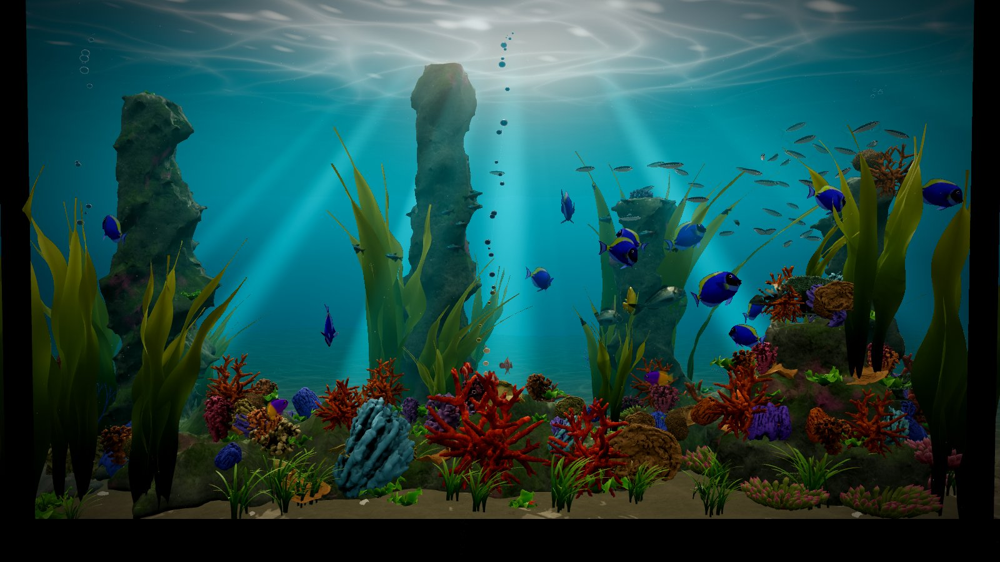
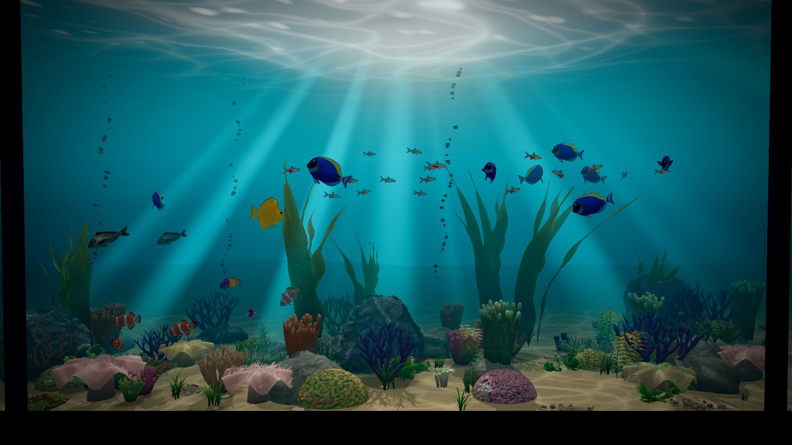
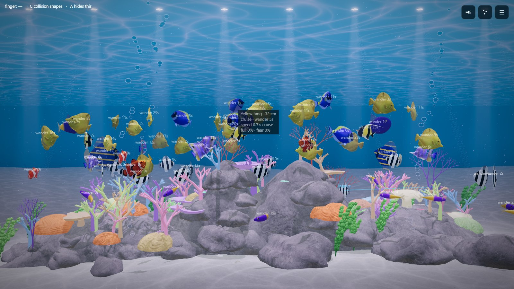
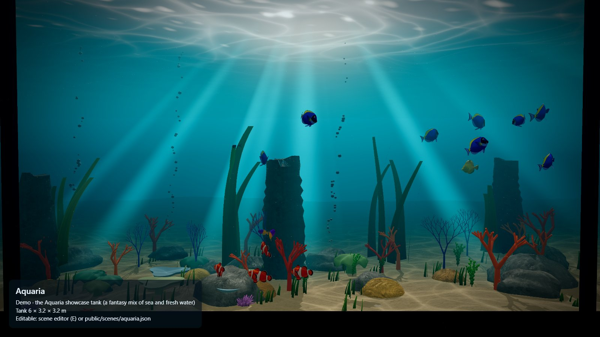
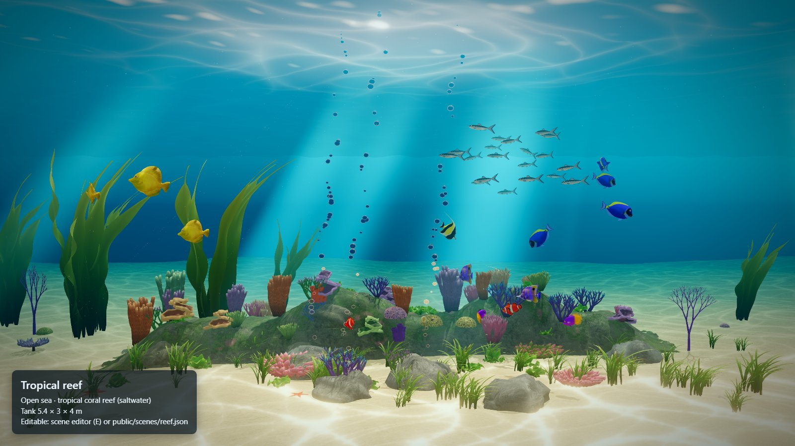
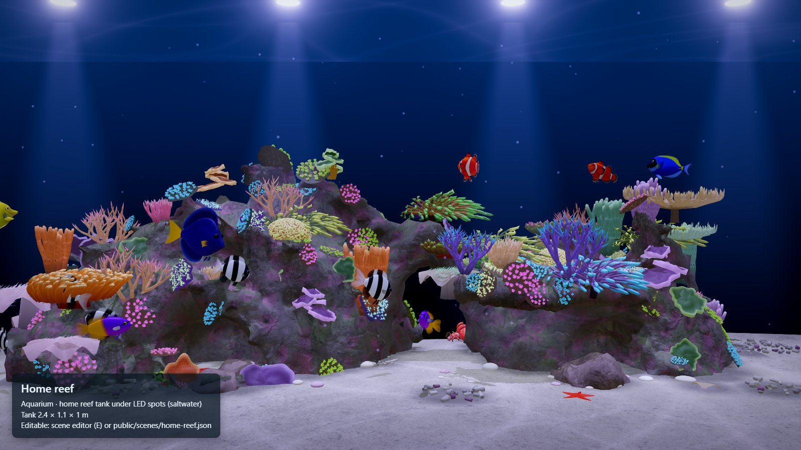
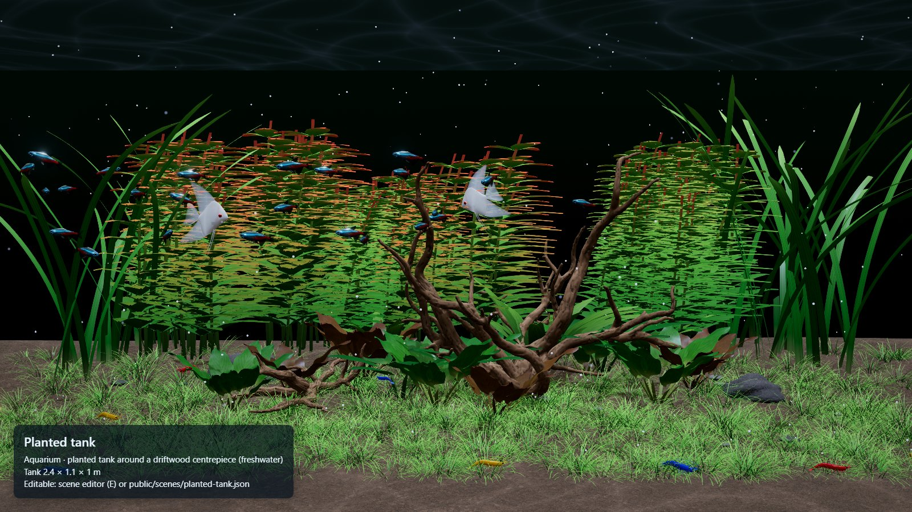
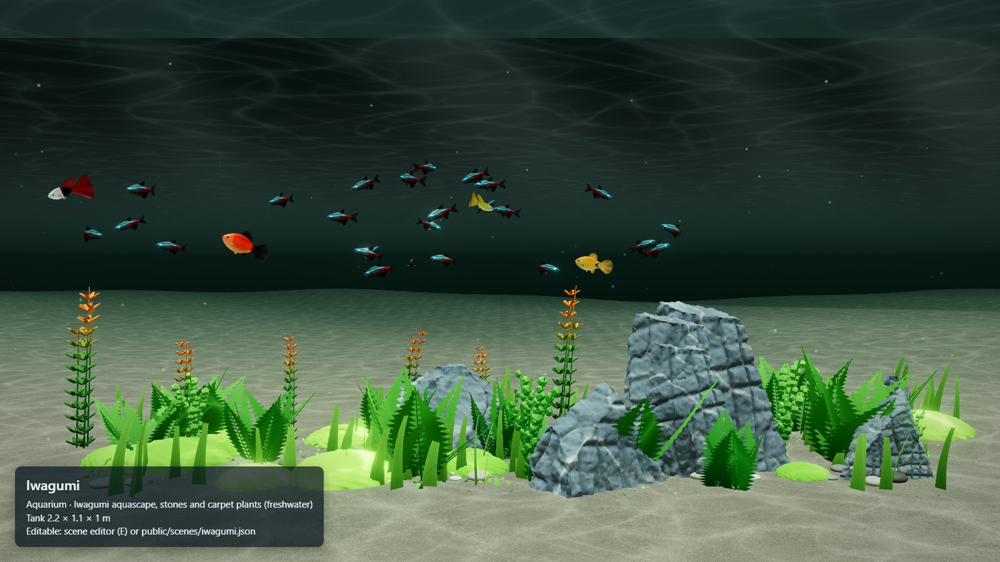

# Aquaria

[](https://nispa.github.io/Aquaria/)

<h3 align="center">▶ <a href="https://nispa.github.io/Aquaria/">Play the live demo</a></h3>

<p align="center">No install: it runs in any recent desktop browser.</p>

A real-time 3D aquarium for the browser, built for large screens: from a
Full HD monitor up to a 4K LED wall. Every tank is described in a JSON file
(water, light, current, plants, rocks and fish), and the engine brings it to
life with Three.js.

In the demo, feed the fish, tap the glass, draw circles to hypnotize them,
light them with a torch (`T`), press `A` to see what each one is doing and `H`
for the control panel. On a laptop, let the browser use the dedicated GPU (see
[Use the dedicated GPU](#use-the-dedicated-gpu)).



<sub>The open reef with most effects on.</sub>



<sub>A reef tank with `A` on: what every fish is doing (wandering, pecking,
inspecting), and a card for the fish under the pointer.</sub>

| [](#bundled-scenes) | [](#bundled-scenes) | [](#bundled-scenes) | [](#bundled-scenes) | [](#bundled-scenes) |
| :----------------------------------------------------: | :-------------------------------------------------------: | :--------------------------------------------------------: | :--------------------------------------------------------------: | :----------------------------------------------------: |
|                        Aquaria                         |                       Tropical reef                       |                         Home reef                          |                           Planted tank                           |                        Iwagumi                         |

## Features

- **Full 3D tank** seen through the glass: the camera frames the front of the
  tank to fill any screen, like a window into the water.
- **Caustics** on the sand, rocks, plants and fish, a rippling surface seen
  from below, light shafts, marine snow and rising bubbles.
- **Living fauna**: boids-based schooling, species habitats across five depth
  bands, 1 to 50 individuals per species with natural size variation. New fish
  swim in from the sides; surplus fish swim away instead of vanishing.
- **Interactive**: feed the fish and watch them rush to the flakes, open
  their mouths and snap them up; rest the pointer on the glass and the
  curious ones come to look; tap the glass and they dart away. Bodies curve
  into every turn and tails beat harder when a fish accelerates.
- **Shared water current** that bends the plants, drifts the particles and
  nudges the fish.
- **Anti-aliasing**: MSAA off, 2x (default), 4x or 8x from the panel, plus an
  optional SMAA pass.
- **Resolution slider** from 540p to 4K, with Full HD and 4K presets, and an
  **automatic resolution** that follows the GPU, plus a frame limit: the
  aquarium never takes the whole GPU and stalls the screen.
- **Made for LED walls**: dithering against banding in dark gradients, no
  permanent on-screen elements, full-screen kiosk use.
- **Every effect is a switch**: turn caustics, shadows, water reflections,
  refractive bubbles, ambient occlusion, volumetric light, depth of field,
  bloom and more on or off live from the panel, and add new effects without
  touching the rest of the engine.
- **Data-driven**: adding a scene or a species means writing JSON, not code.

## Getting started

Requirements: Node.js 22 and pnpm.

```bash
pnpm install
pnpm dev          # open the printed URL
```

Controls:

| Key / action                 | Effect                                                          |
| ---------------------------- | --------------------------------------------------------------- |
| `H`                          | Show or hide the control panel                                  |
| `F`                          | Toggle full screen                                              |
| `Space`                      | Drop a pinch of food (above the pointer if it is over the tank) |
| Rest the pointer on the tank | A finger on the glass: curious fish come to look                |
| Click the tank               | Tap the glass: nearby fish dart away                            |
| Draw quick circles on a fish | Hypnotize it; it comes round dizzy                              |
| Scribble right over a fish   | Tickle it: it wriggles belly up and darts off                   |
| `A`                          | Show what every fish is doing                                   |
| `C` (with `A` on)            | Outline the collision shapes of rocks, corals and wood          |
| `T`                          | Torch: the pointer lights the tank, fish react to the beam      |
| Corner buttons               | Torch, feed, control panel (shown on a mouse move or a touch)   |
| Move the mouse               | Shows the panel button for a moment                             |

All the ways to play with the fish, and how to add more:
[Playing with the fish](docs/INTERACTION.md).

URL options:

| Option    | Example                  | Effect                                             |
| --------- | ------------------------ | -------------------------------------------------- |
| `scene`   | `?scene=home-reef`       | Opens `public/scenes/<scene>.json`, even unlisted  |
| `seed`    | `?seed=7`                | Overrides the scene's random seed                  |
| `frozen`  | `?frozen=10`             | Simulates 10 s and renders one still frame         |
| `effects` | `?effects=shadows,bloom` | Enables exactly these effects (`none` for all off) |
| `hour`    | `?hour=21.5`             | Pins the aquarium time (for demos and screenshots) |

Panel settings (populations, fish size, scenery, lights, effects, resolution, frame limit, fps counter) are saved in the browser.
The resolution follows the GPU by default (_Automatic resolution_ in the Quality section): the
aquarium never takes the whole GPU, which on some machines stalls the whole screen.

## Online version

Every push to `main` that passes CI is published to GitHub Pages at
<https://nispa.github.io/Aquaria/> (workflow `.github/workflows/pages.yml`).
The same URL options work there, e.g. `?scene=home-reef`.

It is an installable web app (PWA): use the browser's _Install_ button (in the
address bar, or _Add to Home screen_ on phones and tablets) to open it full
screen like a program. After the first visit it works offline: the app, scenes
and species are cached at once, textures and fish models once they have been
shown. New versions install themselves and take effect on the next start.

## Running on a wall

Build once, serve the `dist` folder and open it in Chrome in kiosk mode:

```bash
pnpm build
pnpm preview --host
chrome --kiosk --autoplay-policy=no-user-gesture-required http://localhost:4173
```

Disable sleep and the OS screen saver on the machine driving the wall. Start
at 4K, compare with Full HD from your usual viewing distance, and keep the
lowest setting you cannot tell apart: it saves GPU power.

### Use the dedicated GPU

On laptops and PCs with two GPUs, Windows often runs the browser on the
integrated one (Intel, or AMD "Radeon Graphics"), which cannot keep up at 4K.
The panel shows the GPU in use under **Quality**, with a warning when it is
the integrated or a software one. To move Chrome or Edge to the dedicated
GPU:

1. **Windows graphics settings** (the reliable way; they take precedence over
   the NVIDIA and AMD control panels, whose per-app choice browsers often
   ignore): Settings → System → Display → Graphics. Add the browser if it is
   not listed (_Browse_: Edge is
   `C:\Program Files (x86)\Microsoft\Edge\Application\msedge.exe`, Chrome
   `C:\Program Files\Google\Chrome\Application\chrome.exe`), open
   _Options_ and choose **High performance**. Save.
2. **Hardware acceleration on**: `edge://settings/system` (or
   `chrome://settings/system`) → _Use graphics acceleration when available_.
3. **Quit the browser completely.** Edge keeps running in the background
   (18 hidden processes are common): in `edge://settings/system` turn off
   _Startup boost_ and _Continue running background extensions and apps when
   Microsoft Edge is closed_, close every window, and check in Task Manager
   that no `msedge.exe` is left (or run `taskkill /IM msedge.exe /F`). Chrome
   has the same background option in `chrome://settings/system`.
4. **Check**: open `edge://gpu` (or `chrome://gpu`): _GL_RENDERER_ must name
   the NVIDIA or AMD GPU, and the panel's GPU line must match.

On a laptop, keep it on mains power: on battery, Windows may still prefer
the integrated GPU.

## Choosing a scene

The panel (`H`) starts with a **Scene** list; the choice is remembered, so the
plain URL reopens the last scene. The list is `public/scenes/index.json`, in
named groups ("Open sea", "Aquariums"); the first scene is the default.

### Bundled scenes

Four ready-made environments show what the engine can build. They are
examples, not fixed content: each one is a plain JSON file in
`public/scenes/`, and every value (tank, water, light, plants, rocks, fish)
can be changed in the **Scene designer** or in the file itself.

| Scene                                                         | Kind of aquarium                                                                | Tank (w × h × d) |
| ------------------------------------------------------------- | ------------------------------------------------------------------------------- | ---------------- |
| [Aquaria](docs/scenes/aquaria.jpg) (`aquaria`, the default)   | Demo: a showcase tank like the hero image, a fantasy mix of sea and fresh water | 6 × 3.2 × 3.2 m  |
| [Tropical reef](docs/scenes/reef.jpg) (`reef`)                | Open sea: tropical coral reef, saltwater                                        | 5.4 × 3 × 4 m    |
| [Home reef](docs/scenes/home-reef.jpg) (`home-reef`)          | Marine reef aquarium, saltwater                                                 | 6 × 2.6 × 2.4 m  |
| [Planted tank](docs/scenes/planted-tank.jpg) (`planted-tank`) | Planted community aquarium, freshwater                                          | 2.4 × 1.1 × 1 m  |
| [Iwagumi](docs/scenes/iwagumi.jpg) (`iwagumi`)                | Iwagumi aquascape (stones and carpet plants), freshwater                        | 2.2 × 1.1 × 1 m  |


<sub>Default settings, noon, 8 seconds in. Regenerate the pictures with
`pnpm docs:gallery` after changing a scene.</sub>

## Scene designer

**Scene designer** (in the panel, `H`) edits the scene on screen: tank,
water, floor and its material, light and current, the rockwork, every plant
and object entry (add, remove, kind, count, colors or palette, size, depth
band, material, sand or rockwork) and the fish. The LED setup of the Lights
section is saved with the scene.

- **Preview** shows the draft without saving it; with **Auto preview** it
  follows every edit after half a second. Changed values are highlighted and
  **Revert** goes back to the scene you started from. (Each preview restarts
  the fish.)
- **Save as my scene** stores it in this browser, under **My scenes** in the
  scene list; editing one of your scenes offers **Save**, **Save as new** and
  **Delete**.
- **Export JSON** downloads the scene file. To ship it with the project, copy
  it to `public/scenes/` (the file name is its id) and add the id to a group
  in `public/scenes/index.json`. **Import JSON** loads such a file back;
  invalid files are explained field by field.

## Writing scenes

A scene lives in `public/scenes/<id>.json` and is listed in
`public/scenes/index.json` to appear in the panel. The tank is measured in meters:
`x` across the glass, `y` from the sand up to the surface, `z` away from the
glass. Depth is divided into five bands, 0 right behind the glass and 4 at the
back.

```jsonc
{
  "id": "reef",
  "name": "Tropical reef",
  "seed": 20260929,
  "tank": { "width": 5.4, "height": 3, "depth": 4 },
  "water": { "color": "#0a5a7a", "fogDensity": 0.13 },
  "light": { "color": "#fff4dc", "intensity": 1.3, "caustics": { "intensity": 0.9, "scale": 1.4 } },
  "current": { "direction": [1, 0, 0.2], "strength": 0.04, "turbulence": 0.35 },
  "backdrop": { "type": "gradient", "top": "#1a86a8", "bottom": "#021a2a" },
  "floor": { "color": "#d8c49a" },
  "flora": [
    { "kind": "kelp", "count": 10, "bands": [3, 4], "height": [1.4, 2.7], "color": "#5a9a3e" },
  ],
  "props": [
    { "kind": "brain-coral", "count": 4, "color": "#b8a05a" },
    { "kind": "starfish", "count": 1, "color": "#e8612c" },
  ],
  "fauna": [{ "species": "sardine", "count": 45 }],
}
```

Scenery entries:

- `flora` kinds: `kelp`, `seagrass`, `anemone` (tentacles that sway with the
  current), `bush` (grape-like macroalgae), and for planted aquariums
  `carpet`, `fern` and `stem`. A `tipColor` tints the leaves near the top. Each entry sets `count`, depth `bands`, `height` range and `color`.
- `props` kinds: `rock`, `starfish`, `shell`, `brain-coral`, `branch-coral`,
  `fan-coral`, `table-coral`, `mushroom-coral`, `leather-coral`, and for
  aquariums `driftwood`, `dragon-stone`, `moss` and `pebble`. `size` ([min,
  max] m) overrides the kind's default size.
- `water.surface` (0..1) sets how visible the underside of the surface is
  (low for aquariums) and `water.bubbles: false` turns the bubble streams off. Each entry sets `count` and `color`; `bands` is optional (small
  things default to the front, sea fans to the back).
- The floor and any prop entry may set a photographic `material`:
  `{ "id": "reef-rock", "tileSize": 0.45, "displacement": 0.07 }`. The id is a
  folder in `public/assets/materials/` with `normal.ktx2` and `surface.ktx2`;
  `tileSize` is the size of one texture tile in meters and `displacement`
  pushes the surface out by up to that many meters. The entry's `color` still
  sets the hue. A missing material logs a warning and falls back to the plain
  color. Available: sands and gravels `fine-sand`, `coarse-sand`,
  `aquarium-gravel`, `black-gravel`, `aqua-soil`; rocks `reef-rock`,
  `limestone`, `dark-slate`, `layered-rock`, `basalt`, `red-rock`,
  `mossy-rock`; woods `driftwood`, `rough-bark`, `mossy-wood`.
- `color` may be one color or a palette (`["#9a6fc2", "#e08fb0"]`): each item
  then takes one of the colors.
- `rockwork` (optional) builds a reef ridge: a mound of live rock winding
  across the tank with loose rocks piled on it. It sets depth `bands`, crest
  `height` range (m), `coverage` (share of the visible width), `thickness`
  (m), `rocks`, `color` and an optional `material`. Flora and prop entries
  with `"on": "rockwork"` grow on its surface instead of the sand.
- Any entry may have a `name`, used as its label in the panel. Every entry
  gets a slider in the panel's Scenery section; adding items never moves the
  ones already placed.

Species are defined once in `public/species.json`: body shape (`disc`, `round`,
`slender`, or the reef shapes `tall` and `banner`), color pattern (`belly`,
`tail`, `bands`, `split`, or the reef patterns `eye-bar`, `stripes`, `bars`,
`idol`), `base`, `accent` and optional `detail` colors, size, speed, schooling
(0 = solitary, 1 = tight school), depth bands and height range. An optional
`behavior` sets how the species reacts, each from 0 to 1: `appetite` (how keen
it is on food), `curiosity` (the share of individuals that come to look at a
finger on the glass) and `shyness` (how far away a tap on the glass startles
it). An optional `swim` picks how the species swims when nothing calls for its
attention: `cruise`, `burst-coast`, `hover`, `glide` or `patrol`, each with
parameters to tune; see [Swimming styles](docs/SWIMMING.md). Clownfish keep
station over the nearest anemone: plants and objects carry tags (`anemone`,
`shelter`, `coral`…) that fish look for, and a scene entry may set its own
`tags`. An optional `activities` entry lets a species do more than swim
about: `inspect` a place or `peck` at it, choosing places by those tags (press A to
see what each fish is doing). With _Realistic_ on in the Fauna section,
fish keep their hours (`behavior.active`: day, night or always) and rest at
night, and the playful spells are off; `behavior.hiding` sends startled fish
to the nearest shelter. The catalog
includes butterflyfish, moorish idols, emperor angelfish, three-bar damsels and
purple tangs.
Files are validated on load; mistakes are reported with the exact field.

The catalog keeps real lengths. How large fish look is one viewer setting,
**Fish size** in the panel's Fauna section: it pulls every species towards a
reference length of 7% of the tank width. At 0% fish have their real sizes,
at 100% every species is the same size; in between small fish grow and large
ones shrink, keeping their order (default 60%). Speeds scale with the size,
so a fish still swims the same body lengths per second. Releasing the slider
rebuilds the tank.

### 3D fish models

Every species has a procedural body, and may also have a realistic 3D model.
Procedural and 3D fish swim together in the same tank. The panel's Fauna
section shows a card per species, with a picture of the fish drawn live (by a
small renderer of its own, created when the panel first opens and released
right after), its name and a count slider; species in the tank come first.
A **3D** badge on the picture marks the species with a model: click it to switch
that species between its model and the lighter procedural body, or use
**All 3D** / **None 3D**. The choice is saved. A model is downloaded only
when it is shown, and the procedural body stays while it loads or if it
fails. A model is a folder:

```
public/assets/species/barramundi/
  model.json   the manifest: orientation, swimming, credit
  model.glb    the model, textures included
```

Instead of a `.glb`, the folder may hold a `.gltf` with its `.bin` and
texture files next to it. The species points to the folder:

```json
{ "id": "barramundi", "name": "Barramundi", "body": { "type": "procedural", ... }, "model": "barramundi", ... }
```

`model.json`:

```json
{
  "name": "Barramundi",
  "file": "model.glb",
  "forward": "+z",
  "up": "+y",
  "swimAmplitude": 0.06,
  "mouth": { "morphTarget": "MouthOpen" },
  "credit": {
    "author": "Microsoft",
    "source": "https://github.com/KhronosGroup/glTF-Sample-Assets/tree/main/Models/BarramundiFish",
    "license": "CC0-1.0"
  }
}
```

- `forward` and `up` are the model's axes towards the snout and the dorsal
  fin (default `+x` and `+y`). The engine turns, centres and scales the model
  to the species' length, so models can come in any size.
- `swimAmplitude` is the tail sweep in body lengths (default 0.07). The
  model needs no skeleton: the engine bends its rear half to swim and turn.
- `mouth.morphTarget` (optional) is a morph target (a Blender shape key) with
  the mouth wide open, used when the fish eats; without it the mouth stays
  shut.
- `credit.license` must be one of `CC0-1.0`, `CC-BY-3.0`, `CC-BY-4.0`, `MIT`,
  `Apache-2.0`, `BSD-2-Clause`, `BSD-3-Clause`, `0BSD`, `Unlicense`. List the
  model in `ASSETS.md` too; the tests check it.
- Materials are the model's own glTF PBR materials (base color, normal,
  roughness/metalness, occlusion, and extensions such as iridescence). No
  displacement map is needed: the normal map gives the scales their relief.

Optimize a downloaded model before adding it: meshopt geometry, KTX2
textures, and fewer triangles for scanned models (aim for 5,000 to 20,000).
[glTF Transform](https://gltf-transform.dev) does all of it; it needs
KTX-Software (see "Materials") on the `PATH`:

```bash
pnpm dlx @gltf-transform/cli@4.5.1 optimize source.glb public/assets/species/<id>/model.glb   --compress meshopt --texture-compress ktx2 --texture-size 1024 --simplify-ratio 0.05
```

## Lights and day cycle

The tank is lit like a reef aquarium, by four LED channels: white, actinic
blue, violet/UV and a free "accent" color, plus a faint blue moonlight at
night. Under blue and violet, corals and anemones fluoresce.

The **fixture** is either the open sky (one sun, for sea scenes) or an
aquarium lamp with a row of **LED spots**: they shine above the water, with
soft cones of light and pools of light on the bottom.

Panel sections open and close from their headings, and the panel remembers
which ones you left open: Fauna starts open, the more technical ones (Time,
Lights, Scenery, Lighting, Post-processing, Quality) start closed.

The Lights and Time sections start on **Recommended** (the scene's setup).
Changing any control switches to **Custom**, saved in the browser:

- **Fixture**: open sky or LED spots, and how many spots.
- **Cycle** (in Time): _Hour at start_ (the default: the local hour the
  aquarium was started, then still), _Fixed hour_, _Real clock_ (follows the
  local time) or _Accelerated day_ (a whole day in the chosen minutes,
  starting from the chosen hour).
- **Sunrise**, **Sunset** and **Dawn / dusk** length. The blue switches on one
  dawn earlier and off one dusk later than the white, as on real reefs.
- **Color and level** of each channel, and the **moonlight** level.

A scene sets its own recommended lights in a `lights` object with the same
fields (all optional), for example sunlight for an open-sea scene:

```jsonc
"lights": {
  "channels": { "white": { "level": 1 }, "blue": { "level": 0.2 }, "violet": { "level": 0 } },
  "moon": 0.05,
  "fixture": { "type": "sun" },
  "cycle": { "mode": "clock", "sunrise": 8, "sunset": 20, "ramp": 1.5 }
}
```

## Effects

Every effect has its own switch in the control panel (press `H`), so you
choose what the GPU spends its time on.

| Switch              | What it does                                         | Default |
| ------------------- | ---------------------------------------------------- | ------- |
| Caustics            | Moving web of light on sand, rocks, plants and fish  | on      |
| Shadows             | Sun shadows of fish, rocks and plants                | on      |
| Water reflections   | Image-based light from the water around the tank     | on      |
| Refractive bubbles  | Glass-like bubbles instead of sprites                | on      |
| Light shaft planes  | Cheap shafts; redundant with volumetric light        | off     |
| Coral fluorescence  | Corals and anemones glow under blue and violet LEDs  | on      |
| Ambient occlusion   | Darkens creases and contact areas                    | off     |
| Volumetric light    | Shafts through the water, occluded by fish and kelp  | on      |
| Depth of field      | Blurs what is nearer or further than the focus plane | off     |
| Bloom               | Soft glow around the brightest pixels                | on      |
| SMAA anti-aliasing  | Smooths thin edges (grass, fins) that MSAA misses    | off     |
| Vignette and dither | Darker corners; dither against banding on LED walls  | on      |

Ambient occlusion is by far the most expensive (about 18 ms per frame at
1080p on a mid-range GPU) and depth of field looks like blur on a wall seen
with the naked eye, so both start off. Watch the fps counter while you
switch: on the wall, keep the set that stays at 60 fps.

Each effect's parameters and ranges are documented, with their tuned
defaults, in `src/render/effects/`. To add a new effect: create a file there
with `defineEffect` (id, panel name, stage, default on/off, Zod parameter
schema with defaults, `create` returning a Three.js pass), and add it to
`EFFECTS` in `src/render/effects/index.ts`. It appears in the panel; nothing
else in the engine changes.

## Materials

Surface textures are KTX2 files: they stay compressed on the GPU, about a
quarter of the memory of PNG or WebP, which matters at 4K. They are built
from CC0 sources by a script:

```bash
python scripts/build_materials.py            # all materials
python scripts/build_materials.py reef-rock  # just one
```

It needs Python 3 with Pillow and NumPy, and KTX-Software's `ktx` tool. Either
install KTX-Software, or extract its release into the ignored `tools/ktx/`
folder, for example on Windows:

```bash
7z x KTX-Software-4.4.2-Windows-x64.exe -otools/ktx
```

To add a material, add its source to `MATERIALS` in the script, run it, list
the source in `ASSETS.md` and use its id in a scene.

## Development

```bash
pnpm test           # unit tests (Vitest)
pnpm test:coverage  # with coverage thresholds
pnpm test:e2e       # browser tests (Playwright, software WebGL)
pnpm test:visual    # pixel comparison of every scene, frozen frame (on demand)
pnpm docs:gallery   # pictures for the docs: bundled scenes, swimming styles
pnpm lint
pnpm typecheck
pnpm build
```

The code is layered (`core` → `scene` → `sim` → `render`/`ui` → `app`), and
simulation logic runs without a browser so it can be developed test-first.
For in-depth guides and architectural design decisions, see:

- [User & Architectural Learning Guide (English)](docs/USER_GUIDE.md)
- [Guida all'Uso e ai Meccanismi Architetturali (Italiano)](docs/GUIDA_UTENTE.md)
- [AGENTS.md](AGENTS.md) for contributing guidelines, TDD rules, code quality and performance rules.

## Roadmap

- More scenes: Mediterranean seagrass, jellyfish room, shark tunnel, dolphin pool.
- Layered image backdrops with parallax.
- glTF fish (e.g. the CC0 Quaternius animated fish) and a WebGPU renderer.
- Interaction: phone remote (feeding, tapping the glass), webcam presence,
  head-tracked perspective.

## License

Code: [MIT](LICENSE). Third-party assets, when added, are listed with their
licenses in [ASSETS.md](ASSETS.md).
