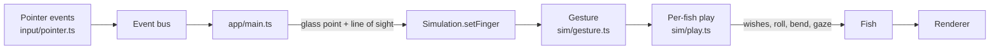

# Playing with the fish

_Italian version: [INTERAZIONE.md](INTERAZIONE.md)._

Watching is half the fun of an aquarium; the other half is playing with the
fish. In Aquaria the mouse (or a finger on a touch screen) is a finger on
the glass, and the fish react to what it does: some come to look, some flee,
and a few gestures do things no real fish would.

## What you can do

| You…                                   | The fish…                                                                                                                        |
| -------------------------------------- | -------------------------------------------------------------------------------------------------------------------------------- |
| **Rest the pointer on the tank**       | The curious ones come to look: they swim up behind the glass and slow down there. The finger counts as gone after 8 s still.     |
| **Click (tap) the tank**               | Those nearby dart away, or run for the nearest shelter and hide there; a startled school packs together. They calm down soon.    |
| **Press `Space`** (or _Feed the fish_) | Flakes drift down above the pointer. Hungry fish swim up to snap them, mouth wide open; full ones lose interest.                 |
| **Draw quick circles near a fish**     | It is **hypnotized**: it stops, floats, follows the finger with its eyes, turns the way of your circles and rolls over and over. |
| **…then stop**                         | It comes round **dizzy**, swimming a wobbly corkscrew for a few seconds.                                                         |
| **Scribble right over a fish**         | It is **tickled**: it wriggles, flips belly up, then darts off in a zigzag.                                                      |
| **Press `A`**                          | Shows what every fish is doing, and a card with the details of the fish nearest the pointer.                                     |

Hypnosis and tickling are deliberately surreal: they are toys, not biology.
Switch _Realistic_ on in the panel's Fauna section and they are off, while
fish keep the hours of their species and rest at night (see
[Swimming styles](SWIMMING.md)). Everything else on this page works in both
modes.

### Who reacts, and how much

Each species tunes its reactions in `public/species.json`, under `behavior`,
from 0 to 1:

- `curiosity`: the share of its individuals that come to look at a finger
  (always the same individuals, so a tank has its regular onlookers).
  They come from up to 3 m away and look from two body lengths behind the
  glass.
- `shyness`: how far a tap startles it, from 30% of 2.5 m for a bold
  species to the full 2.5 m for a shy one.
- `appetite`: how keen it is on food. Fish notice flakes within 3 m and
  leave their habitat by up to 0.5 m to reach them. Each flake fills a fish
  by 15%; above 80% it ignores food, and a full fish empties again over
  five minutes.
- `hiding`: the share of its individuals (always the same ones) that, when
  startled, run for the nearest shelter within 15 body lengths (at least
  1 m) instead of only darting away, and lurk in it for six seconds.
  Shelters are plants and objects tagged `shelter`: anemones, branch and
  table corals, kelp, driftwood, dense plants. A clownfish always hides in
  its own anemone.

A startled fish also alarms its school: the whole school closes up, and
loosens again as the fright fades.

Hypnosis and tickling work on every species alike.

### The spells in detail

**Hypnosis.** Circles count when they are quick (the finger moving at least
0.4 m/s across the glass) and steady (turning one way at 3 rad/s or more,
about half a turn per second). Every fish within 0.6 m of your line of
sight through the finger falls under the spell: fully in 1.2 s. It slows to
a twentieth of its cruise speed, floats at its height, keeps turning the
way of the circles, rolls about its length and keeps its eyes on the
finger. When the circles stop, the spell wears off in 0.6 s; a fish that
was deeply under (80% or more) is then dizzy for 4 s, wobbling its heading,
bobbing up and down and rolling from side to side, less and less as it
recovers.

**Tickling.** Scribbling counts when the finger moves fast (0.6 m/s or more)
and turns a lot, but this way and that rather than round. It must be right
over the fish: within 0.7 body lengths of it (at least 5 cm), seen through
the finger. After 0.4 s of it the fish is tickled for 2.6 s: one second of
wriggling belly up, then a zigzag dash at 2.2 times its cruise speed, and back
upright.

### Seeing what goes on: `A`

`A` shows, over every fish, what it is doing (`wander 12s`, `peck ×3`,
`inspect`) or the spell it is under (`hypnotized 80%`, `dizzy 3s`,
`tickled!`), with a line to the place an activity is about. The fish
nearest the pointer gets a card: species and size, swimming style and
activity, speed relative to cruise speed, how full it is and how
frightened. At the top, a line says what the finger is drawing
(`circles ↺`, `circles ↻`, `scribbling`). Press `A` again to hide it all.

## Who wins

Several things can call for a fish's attention at once. They are weighed
in this order, the first that applies setting the pace:

1. **Fright** after a tap: it flees, whatever else is going on.
2. **Food** nearby, if it is hungry.
3. **A spell**: hypnotized, dizzy or tickled.
4. **Curiosity** about a finger on the glass.
5. **Its activity**: inspecting or pecking at a place.
6. **Its swimming style**: how it swims when nothing else matters.

Anything from 1 to 4 calls off an activity; the fish goes back to wandering
when it is over. Activities and styles are described in
[Swimming styles](SWIMMING.md).

## How it works

1. **Input.** `input/pointer.ts` turns pointer events into `pointer-move`,
   `pointer-leave` and `tap` events on the event bus. Nothing below `app`
   knows about the DOM.
2. **Into the tank.** The app asks the view where the pointer meets the
   front glass, in tank coordinates, and for the direction of the viewer's
   line of sight through it, and hands both to the simulation
   (`setFinger`). Taps become `tap(point)`; food is `dropFood(x, z)`.
3. **Reading the gesture.** Every simulation step, `sim/gesture.ts` follows
   the finger across the glass and keeps smoothed measures: its speed, how
   much its path turns one way (`spin`) and how much it turns at all.
   Sharp reversals (over 150°) count as turning but not as spin, since a
   hair of wobble decides their sign; that is what tells scribbles from
   circles. The measures hold between pointer events, so a slow event rate
   does not read as a stop.
4. **Who it touches.** The simulation measures each fish's distance from
   the line of sight: within 0.6 m it feels circles, within 0.7 body
   lengths it feels scribbles.
5. **The spell.** `sim/play.ts` keeps, for each fish, how deeply it is
   hypnotized, how long it stays dizzy or tickled, and turns that into
   wishes (heading, height, speed, tail) that replace those of its style
   and activity, as activities do. It also drives three posture channels
   the renderer draws: `roll` about the body's length, `bend` (the wriggle)
   and `gaze` (the eyes on the finger).

Everything in steps 3 to 5 is pure simulation code: no DOM, no GPU, seeded
randomness. Tests draw circles and scribbles as lists of points and check
what the fish do.

## Adding an interaction

A new way to play follows the same path:

1. **Input.** If it needs a new source (a phone, a camera, a key), write
   it in `src/input/` and have it emit events on the event bus. Adding a
   source must not require changes in `sim`.
2. **Recognize.** Turn the raw input into something meaningful in tank
   terms with a pure, tested function, as `sim/gesture.ts` does for
   circles and scribbles. Test it with drawn paths, including a slow event
   rate.
3. **React.** Keep any per-fish state with the fish (like `PlayState`) and
   express the reaction as wishes and posture: heading, height, speed,
   response, tail thrust, mouth, steep dives, roll, bend, gaze. Prefer
   these to moving fish directly: the steering keeps them out of the rock
   and inside the tank.
4. **Rank it.** Decide where it goes in [Who wins](#who-wins) and whether it
   calls off activities.
5. **Show it.** Add its state to the `A` overlay (`fishLabel`,
   `fishDetails` in `src/ui/activityOverlay.ts`), so it can be seen and
   tuned.
6. **Document it** here, in both languages.

### Ideas for later

- **Follow the leader**: drag the finger slowly and a school follows it.
- **Flashlight**: at night the pointer is a torch; some species gather in
  its beam, others hide from it.
- **Training**: a double tap always followed by food; after a while the
  fish come to the double tap alone.
- **A favourite**: press and hold on a fish and it follows the pointer
  until you let go.
- **Bubbles**: hold the button to blow a stream of bubbles that fish swim
  through or shy away from.
- From the roadmap: a **phone as a remote**, **presence** in front of the
  screen seen by a webcam, **head tracking** for parallax.
