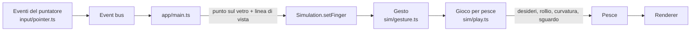

# Giocare con i pesci

_English version: [INTERACTION.md](INTERACTION.md)._

Guardare è metà del divertimento di un acquario; l'altra metà è giocare con
i pesci. In Aquaria il mouse (o un dito su uno schermo touch) è un dito sul
vetro, e i pesci reagiscono a quello che fa: alcuni vengono a guardare,
altri scappano, e qualche gesto fa cose che nessun pesce vero farebbe.

## Cosa puoi fare

| Tu…                                         | I pesci…                                                                                                                             |
| ------------------------------------------- | ------------------------------------------------------------------------------------------------------------------------------------ |
| **Appoggi il puntatore sulla vasca**        | I curiosi vengono a guardare: si avvicinano dietro il vetro e lì rallentano. Dopo 8 s di puntatore fermo il dito conta come tolto.   |
| **Clicchi (tocchi) la vasca**               | Quelli vicini scappano di scatto, o corrono a nascondersi nel rifugio più vicino; un banco spaventato si stringe. Si calmano presto. |
| **Premi `Spazio`** (o _Feed the fish_)      | Scendono fiocchi sopra il puntatore. I pesci affamati salgono ad azzannarli a bocca spalancata; quelli sazi perdono interesse.       |
| **Disegni cerchi veloci vicino a un pesce** | Resta **ipnotizzato**: si ferma, galleggia, segue il dito con gli occhi, gira nel verso dei tuoi cerchi e si avvita su se stesso.    |
| **…poi smetti**                             | Si risveglia **stordito** e per qualche secondo nuota a cavatappi, barcollando.                                                      |
| **Scarabocchi proprio sopra un pesce**      | Gli fai il **solletico**: si contorce, si gira a pancia in su, poi scappa a zig-zag.                                                 |
| **Premi `A`**                               | Mostra cosa sta facendo ogni pesce, e una scheda con i dettagli del pesce più vicino al puntatore.                                   |
| **Premi `T`** (o il pulsante della torcia)  | Il puntatore diventa una **torcia**: i pesci che amano la luce si radunano nel fascio, i timidi scappano. Meglio di notte.           |
| **Premi `Z`** (o il pulsante della lente)   | Una **lente** rotonda sopra il puntatore mostra la vasca tre volte più grande: per guardare un pesce da vicino.                      |

Muovendo il mouse o toccando lo schermo compaiono in alto a destra tre
pulsanti, grandi abbastanza per un dito: la **torcia**, il **cibo** (un
pizzico di fiocchi) e il **pannello di controllo**. Svaniscono dopo pochi
secondi, così sullo schermo non resta niente di fisso.

Ipnosi e solletico sono volutamente surreali: sono giochi, non biologia.
Attiva _Realistic_ nella sezione Fauna del pannello e si spengono, mentre i
pesci seguono gli orari della loro specie e di notte riposano (vedi
[Stili di nuoto](NUOTO.md)). Tutto il resto di questa pagina vale in
entrambe le modalità.

### Chi reagisce, e quanto

Ogni specie regola le sue reazioni in `public/species.json`, sotto
`behavior`, da 0 a 1:

- `curiosity`: la quota dei suoi individui che vengono a guardare un dito
  (sempre gli stessi, così una vasca ha i suoi spettatori abituali).
  Arrivano da 3 m al massimo e guardano da due lunghezze del corpo dietro
  il vetro.
- `shyness`: da quanto lontano la spaventa un tocco, dal 30% di 2,5 m per
  una specie audace ai 2,5 m interi per una timida.
- `appetite`: quanto è golosa. I pesci notano i fiocchi entro 3 m ed escono
  dal loro habitat fino a 0,5 m per raggiungerli. Ogni fiocco sazia un pesce
  del 15%; sopra l'80% ignora il cibo, e un pesce sazio si svuota del tutto
  in cinque minuti.
- `hiding`: la quota dei suoi individui (sempre gli stessi) che, spaventati,
  corrono al rifugio più vicino entro 15 lunghezze del corpo (almeno 1 m)
  invece di scappare soltanto, e ci restano nascosti per sei secondi. I
  rifugi sono piante e oggetti col tag `shelter`: anemoni, coralli
  ramificati e a tavola, kelp, legni, piante fitte. Un pesce pagliaccio si
  nasconde sempre nel suo anemone.
- `torch`, da -1 a 1: come prende la torcia. Sopra 0 è attirata dal
  fascio fino a 3 m di distanza e ci gira dentro piano (sardine, tetra, il
  barramundi); sotto 0 scappa dal fascio e, se si nasconde, si nasconde
  per quattro secondi (grammi, damigelle, gourami). A 0 non le importa.

Un pesce spaventato allarma anche il suo banco: tutto il banco si stringe,
e si riallarga man mano che lo spavento passa.

Ipnosi e solletico funzionano allo stesso modo su tutte le specie.

### Gli incantesimi nel dettaglio

**Ipnosi.** I cerchi contano quando sono veloci (il dito si muove sul vetro
ad almeno 0,4 m/s) e regolari (girano da una parte sola ad almeno 3 rad/s,
circa mezzo giro al secondo). Ogni pesce entro 0,6 m dalla tua linea di
vista attraverso il dito cade sotto l'incantesimo, del tutto in 1,2 s.
Rallenta a un ventesimo della sua velocità di crociera, galleggia alla sua
quota, continua a girare nel verso dei cerchi, rolla attorno alla sua
lunghezza e tiene gli occhi sul dito. Quando i cerchi finiscono,
l'incantesimo svanisce in 0,6 s; un pesce che era ipnotizzato a fondo (80%
o più) resta poi stordito per 4 s: ondeggia la rotta, sale e scende,
rolla da un lato all'altro, sempre meno man mano che si riprende.

**Solletico.** Lo scarabocchio conta quando il dito va veloce (almeno 0,6
m/s) e gira molto, ma di qua e di là invece che in tondo. Deve essere
proprio sopra il pesce: entro 0,7 lunghezze del corpo (almeno 5 cm), visto
attraverso il dito. Dopo 0,4 s il pesce ha il solletico per 2,6 s: un
secondo contorcendosi a pancia in su, poi uno scatto a zig-zag a 2,2 volte
la sua velocità di crociera, e di nuovo dritto.

### La lente: `Z`

Con la lente accesa (`Z` o il suo pulsante d'angolo), una lente rotonda
segue il puntatore e mostra ciò che c'è sotto tre volte più grande, visto
dal tuo occhio come il resto della vasca. Il puntatore resta un dito sul
vetro, così i pesci curiosi vengono a guardarti attraverso la lente.

### La torcia: `T`

Con la torcia accesa (`T` o il suo pulsante d'angolo, che si illumina
finché è accesa), il puntatore proietta un fascio dal tuo occhio,
attraverso il vetro, dentro la vasca: una luce calda che si allarga con la
profondità. I pesci reagiscono come dice il `torch` della loro specie, in
pieno di notte e per circa un terzo di giorno, quando una torcia quasi non
si vede. Finché è accesa il puntatore è una torcia e non un dito: i
curiosi non vengono a guardare, e cerchi e scarabocchi non fanno
incantesimi. Tocchi e cibo funzionano come sempre.

### Vedere cosa succede: `A`

`A` mostra sopra ogni pesce cosa sta facendo (`wander 12s`, `peck ×3`,
`inspect`) o l'incantesimo in cui si trova (`hypnotized 80%`, `dizzy 3s`,
`tickled!`), con una linea verso il luogo di cui si occupa un'attività. Il
pesce più vicino al puntatore ha una scheda: specie e misura, stile di nuoto
e attività, velocità rispetto alla crociera, quanto è sazio e quanto è
spaventato. In alto una riga dice cosa sta disegnando il dito
(`circles ↺`, `circles ↻`, `scribbling`). Premi di nuovo `A` per
nascondere tutto. Con l'overlay acceso, `C` disegna il contorno delle
forme di collisione di rocce, coralli e legni (vedi
[Stili di nuoto](NUOTO.md#collisioni)).

## Chi vince

Più cose possono richiedere l'attenzione di un pesce nello stesso momento.
Si valutano in quest'ordine, e la prima che vale impone il ritmo:

1. **Lo spavento** dopo un tocco: scappa, qualunque cosa stia succedendo.
2. **Il cibo** vicino, se ha fame.
3. **Un incantesimo**: ipnotizzato, stordito o col solletico.
4. **La torcia**, finché è accesa; altrimenti **la curiosità** per un dito
   sul vetro.
5. **La sua attività**: ispezionare o becchettare un luogo.
6. **Il suo stile di nuoto**: come nuota quando nient'altro conta.

Qualunque cosa da 1 a 4 interrompe un'attività; il pesce torna a vagare
quando è finita. Attività e stili sono descritti in
[Stili di nuoto](NUOTO.md).

## Come funziona

1. **Input.** `input/pointer.ts` trasforma gli eventi del puntatore in
   `pointer-move`, `pointer-leave` e `tap` sull'event bus. Niente sotto
   `app` conosce il DOM.
2. **Dentro la vasca.** L'app chiede alla vista dove il puntatore incontra
   il vetro frontale, in coordinate della vasca, e la direzione della linea
   di vista attraverso quel punto, e passa entrambi alla simulazione
   (`setFinger`). I tocchi diventano `tap(point)`; il cibo è
   `dropFood(x, z)`.
3. **Leggere il gesto.** A ogni passo della simulazione `sim/gesture.ts`
   segue il dito sul vetro e tiene misure smussate: la sua velocità, quanto
   il percorso gira da una parte (`spin`) e quanto gira in tutto. Le
   inversioni brusche (oltre 150°) contano come svolte ma non come giro,
   perché il loro segno lo decide un tremolio: è questo che distingue gli
   scarabocchi dai cerchi. Le misure restano valide tra un evento e
   l'altro, così pochi eventi al secondo non sembrano una sosta.
4. **Chi tocca.** La simulazione misura la distanza di ogni pesce dalla
   linea di vista: entro 0,6 m sente i cerchi, entro 0,7 lunghezze del
   corpo sente gli scarabocchi.
5. **L'incantesimo.** `sim/play.ts` tiene, per ogni pesce, quanto è
   ipnotizzato e per quanto resta stordito o col solletico, e lo traduce in
   desideri (direzione, quota, velocità, coda) che sostituiscono quelli di
   stile e attività, come fanno le attività. Muove anche tre canali di
   postura che il renderer disegna: `roll` attorno alla lunghezza del
   corpo, `bend` (il contorcersi) e `gaze` (gli occhi sul dito).

Tutto dal punto 3 al 5 è codice di simulazione puro: niente DOM, niente
GPU, casualità con seme. I test disegnano cerchi e scarabocchi come liste
di punti e verificano cosa fanno i pesci.

## Aggiungere un'interazione

Un nuovo modo di giocare segue la stessa strada:

1. **Input.** Se serve una nuova sorgente (un telefono, una webcam, un
   tasto), scrivila in `src/input/` e falle emettere eventi sull'event bus.
   Aggiungere una sorgente non deve richiedere modifiche in `sim`.
2. **Riconoscere.** Trasforma l'input grezzo in qualcosa di significativo in
   termini di vasca con una funzione pura e testata, come fa
   `sim/gesture.ts` per cerchi e scarabocchi. Testala con percorsi
   disegnati, anche con pochi eventi al secondo.
3. **Reagire.** Tieni l'eventuale stato per pesce con il pesce (come
   `PlayState`) ed esprimi la reazione come desideri e postura: direzione,
   quota, velocità, prontezza, spinta della coda, bocca, picchiate, rollio,
   curvatura, sguardo. Preferiscili allo spostare i pesci direttamente: la
   guida li tiene fuori dalla roccia e dentro la vasca.
4. **Darle un posto.** Decidi dove va in [Chi vince](#chi-vince) e se
   interrompe le attività.
5. **Mostrarla.** Aggiungi il suo stato all'overlay della `A` (`fishLabel`,
   `fishDetails` in `src/ui/activityOverlay.ts`), così si vede e si può
   tarare.
6. **Documentarla** qui, nelle due lingue.

### Idee per il futuro

- **Segui il capo**: trascini il dito piano e un banco lo segue.
- **Addestramento**: un doppio tocco seguito sempre dal cibo; dopo un po' i
  pesci accorrono al solo doppio tocco.
- **Il preferito**: tieni premuto su un pesce e lui segue il puntatore
  finché non lasci.
- **Bolle**: tenendo premuto soffi una scia di bolle che i pesci
  attraversano o evitano.
- Dalla roadmap: il **telefono come telecomando**, la **presenza** davanti
  allo schermo vista da una webcam, l'**head tracking** per la parallasse.
