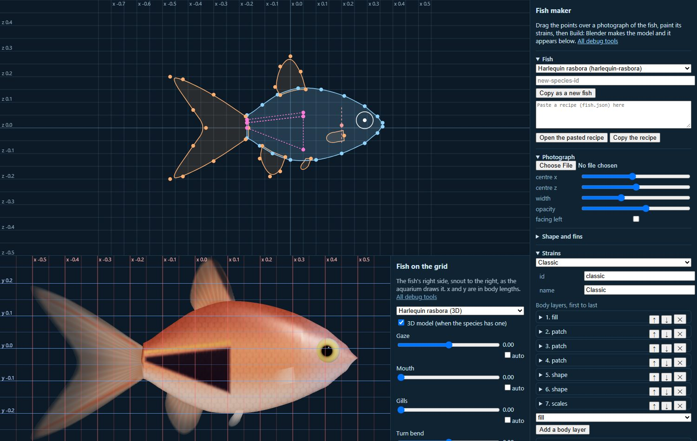
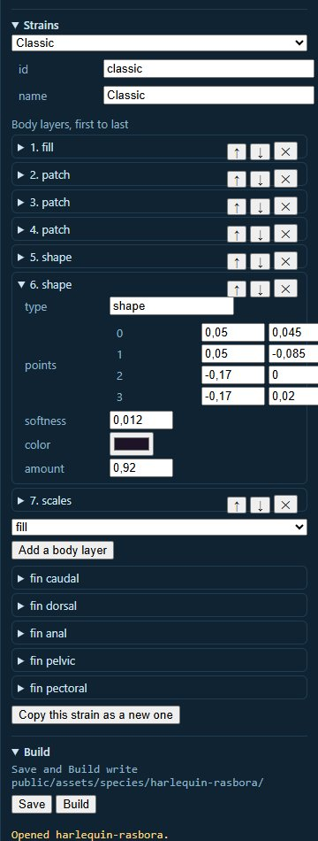

# Modelli 3D dei pesci

_English version: [FISH_MODELS.md](FISH_MODELS.md)._

Ogni specie ha un corpo che Aquaria disegna da solo. Può avere anche un
modello 3D, e chi guarda sceglie quale vedere (il bollino **3D** sulla
scheda della specie nel pannello). Il modello si scarica solo quando viene
mostrato, e se non si carica resta il corpo disegnato.

Questa pagina spiega come aggiungere un modello trovato in giro, e come
farne uno in Blender.

## La cartella

```
public/assets/species/<id>/
  model.json   come Aquaria deve usare il modello
  model.glb    il modello, texture comprese
  colorings/   facoltativa: una texture per colorazione (vedi Colorazioni)
```

Va bene anche un `.gltf` con accanto il suo `.bin` e le texture. La specie
punta alla cartella con `"model": "<id>"` in `public/species.json`.

## model.json

Quello del platy, per esempio:

```json
{
  "name": "Platy",
  "file": "model.glb",
  "forward": "+x",
  "up": "+y",
  "swimAmplitude": 0.08,
  "mouth": { "morphTarget": "MouthOpen" },
  "eyes": { "bones": ["Eye.L", "Eye.R"], "turn": 22 },
  "gills": { "edge": 0.299, "top": 0.069, "bottom": -0.081, "curve": 4 },
  "credit": {
    "author": "Aquaria (fish.json, built by scripts/blender/fishbuild.py)",
    "source": "https://github.com/nispa/Aquaria/blob/main/public/assets/species/platy/fish.json",
    "license": "CC0-1.0"
  }
}
```

(Il file vero ha anche `fins` e `colorings`, spiegati più sotto.)

- `forward` e `up`: quali assi del modello puntano verso il muso e verso
  il dorso. Aquaria ruota, centra e scala il modello alla lunghezza della
  specie, quindi va bene qualsiasi misura e orientamento.
- `swimAmplitude`: quanto si muove la coda, in lunghezze del corpo (di
  partenza 0.07). Il modello non ha bisogno di un'animazione di nuoto: lo
  piega Aquaria.
- `mouth`, `eyes`, `gills`, `fins`: facoltativi, vedi sotto. Senza, la
  bocca resta chiusa, gli occhi fermi e branchie e pinne immobili.
- `colorings`: facoltativo, vedi
  [Colorazioni](#colorazioni-un-modello-tanti-ceppi).
- `credit`: chi l'ha fatto, da dove viene e la licenza. Sono accettate solo
  licenze che permettono riuso, modifiche e uso commerciale: `CC0-1.0`,
  `CC-BY-3.0`, `CC-BY-4.0`, `MIT`, `Apache-2.0`, `BSD-2-Clause`,
  `BSD-3-Clause`, `0BSD`, `Unlicense`. Il modello va elencato anche in
  `ASSETS.md`; un test lo controlla.

Il modello tiene i suoi materiali e le sue texture, a meno che la sua
specie non porti una colorazione.

## Guardarlo: il pesce sul piano millimetrato

Avvia `pnpm dev` e apri `/model-viewer.html?id=<specie>` (o sceglilo da
`/debug.html`). Mostra il pesce dal lato destro, esattamente come lo
disegna l'acquario, sopra una griglia in lunghezze del corpo: la coda a
-0,5, il muso a +0,5, il dorso in alto.

I cursori di lato muovono occhi, bocca, branchie, la piega della virata,
la coda e il nuoto. Spunta **auto** e il cursore va avanti e indietro da
solo. La casella **3D** passa dal modello al corpo disegnato.

È qui che leggi le posizioni che chiedono `mouth.jaw`, `eyes.painted`,
`gills` e `fins.pectoral`. Due cursori muovono le pinne pettorali:
**Pectoral spread** le chiude (-1) e le apre (1), **Pectoral beats/s** le fa
battere. Con `&view=top` nell'indirizzo il pesce si vede dall'alto, e le
righe orizzontali della griglia leggono z: lì si misura quanto la pinna
sporge dal fianco.

## Un modello trovato in giro

I modelli scaricati sono spesso pesanti. Prima di aggiungerne uno,
comprimilo con [glTF Transform](https://gltf-transform.dev) (serve
KTX-Software nel `PATH`, vedi [Fare una texture nuova](SCRIVERE_SCENE.md#fare-una-texture-nuova)):

```bash
pnpm dlx @gltf-transform/cli@4.5.1 optimize sorgente.glb public/assets/species/<id>/model.glb --compress meshopt --texture-compress ktx2 --texture-size 1024
```

Punta a 5.000-20.000 triangoli. Le scansioni di esemplari veri di solito
pesano molto di più, e in acqua sembrano morte: spesso rendono male.

Un modello così di solito ha gli occhi dipinti e nessuna posa a bocca
aperta. Puoi comunque fargli guardare in giro, mangiare e respirare, con
posizioni lette sulla griglia:

```json
"mouth": { "jaw": { "start": 0.43, "line": -0.01, "drop": 0.02 } },
"eyes": { "painted": { "center": [0.37, 0.137], "radius": 0.024, "pupil": 0.72, "iris": "#d6dee6" } },
"gills": { "edge": 0.28, "top": 0.17, "bottom": -0.06, "curve": 3 }
```

- `mouth.jaw`: tutto quello che sta davanti a `start` e sotto `line` (dove
  si chiudono le labbra) si abbassa, fino a `drop` sulla punta del muso.
- `eyes.painted`: un occhio nuovo disegnato sopra quello dipinto, sui due
  lati. Fai `radius` abbastanza grande da coprire la vecchia pupilla.
  `pupil` è quanto è grande la pupilla rispetto all'occhio (di partenza
  0.65); si sposta con lo sguardo.
- `gills`: il bordo posteriore dell'opercolo (`edge`), quanto sale e
  scende (`top`, `bottom`), e quanto è curvo (`curve`, 0 è dritto). Si
  solleva di `open` (di partenza 0.006) circa una volta al secondo
  (`rate`), ogni pesce per conto suo.

### Le pinne pettorali

Le pettorali sono le pinne dietro le branchie. Un pesce pagliaccio fermo
sopra l'anemone le batte una dopo l'altra, tre o quattro volte al secondo;
quando nuota spinge con la coda e le pettorali remano insieme, più piano;
in uno scatto le chiude contro il corpo; per frenare le apre tutte e due,
e in virata apre quella all'interno della curva. Questo vale per tutti i
pesci: lo stesso shader muove le pinne di ogni modello e di ogni corpo
disegnato. A un modello basta dire dove sono, come il pesce pagliaccio:

```json
"fins": {
  "pectoral": {
    "root": [[0.21, 0.04], [0.17, -0.095]],
    "side": 0.095,
    "front": 0.225,
    "back": 0.025,
    "top": 0.12,
    "bottom": -0.11,
    "rest": 35,
    "sweep": 35
  }
}
```

- `front`, `back`, `top`, `bottom`: un riquadro sul fianco (x e y) che
  contiene tutta la pinna e nessun'altra.
- `side`: quanto lontano dal centro del corpo (z, dalla vista dall'alto)
  comincia la pinna. Nel riquadro si muove solo quello che sporge oltre:
  il fianco resta fermo. Aquaria sfuma la pinna nel corpo negli ultimi
  0.015 prima di `side`, quindi mettilo circa 0.017 oltre il punto più
  largo della pelle nel riquadro, non sulla pelle: lì il fianco si muove
  con la pinna come un'ala (dall'alto, con **Pectoral spread** a 1).
- `root`: l'estremità alta e quella bassa della base della pinna, la linea
  attorno a cui ruota.
- `rest`: di quanti gradi la pinna del modello si stacca dal corpo
  (di partenza 30); chiusa, ruota indietro di tanto e si appoggia al fianco.
- `sweep`: di quanti gradi oscilla in un battito pieno (di partenza 35).

Controlla sul visore con **Pectoral spread** a -1 (la pinna deve
appoggiarsi al corpo senza attraversarlo) e a 1. Il corpo disegnato ha le
sue pettorali, che si muovono allo stesso modo. Un modello fatto in Blender
le può avere come lastre separate dal corpo: il riquadro le trova lo
stesso. La lastra deve partire dalla pelle, non da dentro, o `side` non
la distingue dal fianco: `pectoral_fin` in `scripts/blender/fishkit.py`
appoggia la base sulla pelle e la inclina in fuori di 30 gradi, come sul
gramma reale, e gli script stampano tutto il blocco `fins.pectoral`.

Un pesce che allunga la bocca in avanti quando la apre, come l'orata o il
barramundi, con `jaw` viene male. Gli serve una vera posa a bocca aperta
fatta in Blender: `scripts/blender/seabream.py` la prende dall'animazione
della mandibola del modello stesso, `scripts/blender/barramundi.py` la
costruisce a mano.

## Fare un pesce in Blender

### Da una ricetta

Guppy, platy, pesce angelo, royal gramma, sardina e rasbora arlecchino
sono ricette: un
`fish.json` nella loro cartella dice com'è il pesce, e
`scripts/blender/fishbuild.py` lo costruisce in Blender. Quella del
platy, accorciata:

```jsonc
{
  "name": "Platy",
  "body": {
    "top": [
      [0.3, 0.018],
      [0.25, 0.07],
      [0.11, 0.128],
      /* … */ [-0.16, 0.058],
    ],
    "bottom": [
      [0.3, 0.004],
      [0.25, -0.058],
      [0.09, -0.125],
      /* … */ [-0.16, -0.052],
    ],
    "thickness": {
      "half": 0.06,
      "rise": 0.3,
      "power": 0.5,
      "taper": 0.55,
      "taperFrom": 0.35,
      "min": 0.014,
    },
    "roundness": 0.8,
  },
  "eye": {
    "x": 0.235,
    "z": 0.03,
    "radius": 0.027,
    "depth": 0.5,
    "rim": "#3a2a20",
    "iris": "#e0a830",
    "pupil": "#080808",
    "irisEdge": [55, 65],
    "pupilEdge": [28, 34],
  },
  "fins": [
    {
      "id": "dorsal",
      "type": "body",
      "upper": true,
      "start": 0.07,
      "end": -0.085,
      "outline": [
        [0.05, 0.19],
        [0.0, 0.215],
        [-0.06, 0.205],
        [-0.1, 0.15],
        [-0.105, 0.095],
      ],
    },
    {
      "id": "pectoral",
      "type": "pectoral",
      "root": [0.19, -0.035],
      "base": [-0.004, 0.04],
      "length": 0.072,
      "angles": [20, -40],
    },
    // … the tail, the anal and pelvic fins
  ],
  "strains": [
    {
      "id": "mickey-mouse",
      "name": "Mickey Mouse",
      "body": [
        { "type": "fill", "color": "#f6b83a" },
        { "type": "patch", "color": "#d68a18", "bands": [{ "axis": "up", "range": [0.1, 0.85] }] },
        {
          "type": "marks",
          "color": "#111111",
          "amount": 0.95,
          "marks": [
            [-0.1, 0.0, 0.026],
            [-0.132, 0.03, 0.015],
            [-0.132, -0.03, 0.015],
          ],
        },
        { "type": "scales", "size": 0.018, "rim": 0.08 },
      ],
      "fins": {
        "dorsal": {
          "rayed": {
            "web": "#f8c860",
            "ray": "#e0a030",
            "root": "#f0a030",
            "alphaRoot": 0.7,
            "alphaEdge": 0.35,
            "rays": 22,
          },
        } /* … */,
      },
    },
  ],
}
```

- `body`: il profilo visto di lato, sopra e sotto, come punti (x, z) dal
  muso al peduncolo caudale, in lunghezze del corpo (il +X di Blender è il
  muso, il +Z il dorso); quanto è spesso (metà dello spessore nel punto
  più largo, fin dove cresce, quanto si assottiglia) e quanto è tondo in
  sezione.
- `eye`, `mouth` (quanto si allunga e quanto scende la shape key) e
  `gills` (dove finisce l'opercolo, per `model.json`).
- `fins`: ognuna con un id, il suo rettangolo nella texture, e un tipo:
  `body` (dorsale, anale o gonopodio, lungo il dorso o il ventre), `tail`,
  `pectoral`, `pelvic` (a ventaglio o a lama) o `filament` (quelle del
  pesce angelo).
- `texture`: la misura e dove sta ogni parte.
- `strains`: ogni ceppo dipinge il corpo con una pila di strati (`fill`,
  `patch`, `edge`, `marks`, `noise`, `noiseLines`, `eyeLine`, `rays`,
  `gillCurve`, `shape`, `scales`) e ogni pinna con una trama raggiata e
  strati sopra (`tint`, `dots`, `noiseLines`, `marks`, `shape`). Una
  `shape` è un poligono qualsiasi di punti visti di lato, con il bordo
  sfumato: il cuneo nero della rasbora arlecchino, le strisce sulla sua
  coda. `finPaint` contiene le pinne che tutti i ceppi dipingono uguali.

Ogni campo sta in `src/scene/fishRecipe.ts`, con cui un test controlla
ogni ricetta; gli strati li disegna `scripts/blender/fishpaint.py`.
Costruiscilo in una cartella tua, comprimi il modello nella cartella della
specie, copia `colorings/` e unisci `model-values.json` (branchie, pinne
pettorali, colorazioni) a `model.json`:

```bash
blender --background --python scripts/blender/fishbuild.py -- public/assets/species/platy/fish.json out/platy
pnpm dlx @gltf-transform/cli@4.5.1 optimize out/platy/model.glb public/assets/species/platy/model.glb --compress meshopt --simplify false
```

Senza cartella il costruttore scrive nella cartella della ricetta, senza
comprimere. Il gamberetto red cherry è ancora uno script a sé,
`scripts/blender/shrimp.py`, sugli stessi pezzi comuni (`fishkit.py`,
`paintkit.py`).

### Con il fish maker



Con `pnpm dev` apri `/fish-designer.html` (anche da `/debug.html`). A
sinistra la ricetta è disegnata di lato su una griglia in lunghezze del
corpo: il corpo in blu, le pinne in arancione, l'occhio e il bordo
dell'opercolo. Scegli una foto del pesce vero, visto di lato, e mettila
sotto il disegno con i cursori (centro, larghezza, trasparenza, e
_facing left_ per un pesce girato dall'altra parte). Poi trascina i punti
finché il profilo segue la foto: il profilo del corpo, quello di ogni
pinna e dove comincia e finisce, le radici delle pinne pettorali e
pelviche, l'occhio, e gli angoli delle forme del ceppo aperto (in
rosa).

A destra, _Shape and fins_ contiene i numeri che si scrivono invece di
trascinarli (spessore, rotondità, la misura dell'occhio, gli angoli delle
pinne), e _Strains_ la pittura: gli strati del corpo di un ceppo dal primo
all'ultimo, che puoi spostare, togliere o aggiungere, e il pittore di
ogni pinna.



_Copy as a new fish_ comincia una specie nuova da quella aperta: scrivi
il suo id, premi il pulsante, e la riga sopra Save mostra la cartella in
cui verrà scritta. Un id scritto ma non confermato blocca Save, così il
pesce da cui sei partito non viene mai sovrascritto. _Paste a recipe_ e
_Open the pasted recipe_ portano dentro una ricetta scritta altrove;
_Copy the recipe_ mette negli appunti quella aperta.

**Save** controlla la ricetta e la scrive. **Build** la salva, lancia
Blender (`$BLENDER`, oppure il più recente installato dove lo mettono gli
installer, oppure `blender` nel `PATH`), comprime il modello nella
cartella della specie, scrive le colorazioni, unisce i valori misurati a
`model.json` e mostra il risultato nel model viewer sotto il disegno. Una
specie nuova ha bisogno anche della sua voce in `public/species.json`
prima che il viewer e la vasca la possano mostrare.

### Con un assistente AI

Un assistente che legge le immagini e scrive JSON, come Claude, può
disegnare una prima versione della ricetta partendo da una foto; il fish
maker è il posto dove la confronti con la stessa foto e la correggi. Ci
sono due strade.

- **Un assistente che lavora nel repository**, come Claude Code: legge
  da solo il formato (`src/scene/fishRecipe.ts`) e le ricette che ci
  sono, scrive `public/assets/species/<id>/fish.json`, e può costruirla
  e guardare il risultato. Poi aprila nel fish maker.
- **Un assistente in una chat**: dagli la foto, una ricetta d'esempio e il
  formato, poi incolla la sua risposta nel fish maker (_Paste a recipe_,
  _Open the pasted recipe_).

Passo per passo:

1. Trova una foto del pesce di lato, il più dritta possibile, con le
   pinne aperte. Resta sul tuo computer; nel repository va solo la
   ricetta.
2. Chiedi la ricetta. Un prompt che funziona:

```text
Ecco la foto di un barbo ciliegia, visto di lato. Fai una ricetta di pesce
per Aquaria (fish.json).

Segui il formato di src/scene/fishRecipe.ts e la ricetta d'esempio che ti
allego (la rasbora arlecchino). Le coordinate sono in lunghezze del
corpo: x lungo il pesce, il muso a circa +0.36, il peduncolo caudale fra
-0.15 e -0.25, la punta della coda verso -0.5; z verso l'alto, il centro
del corpo vicino a 0.

Traccia il profilo di sopra e di sotto con 8-10 punti ciascuno, ogni
pinna come contorno, la posizione e la misura dell'occhio. Dipingi un
ceppo, "classic": un fill, il dorso più scuro e la pancia più chiara
(patch su "up"), i segni che vedi (shape per strisce e macchie), poi le
squame. Pinne trasparenti, con i raggi.

Rispondi solo con il JSON.
```

3. Apri la ricetta nel fish maker, metti sotto la stessa foto e trascina
   quello che l'assistente ha sbagliato: di solito il corpo è vicino, le
   pinne, l'occhio e la forcella della coda meno. Build.
4. Mostragli il risultato: uno screenshot del model viewer e la ricetta
   (_Copy the recipe_), con quello che non va in parole semplici ("il
   cuneo nero comincia troppo avanti", "la coda è troppo pallida").
   Incolla la sua risposta e rifai Build. Quando Save rifiuta una
   ricetta, mandagli il messaggio: dice quale campo.
5. Per altri ceppi, dagli una foto di ogni forma di colore e chiedigli un
   ceppo per ciascuna, con la stessa forma.
6. Salva, poi dai alla specie `"model"` e `"coloring"` in
   `public/species.json` e scrivi il modello in `ASSETS.md`, come per ogni
   nostro pesce.

### A mano

Se modelli a mano:

1. **Forma.** Muso verso il +X di Blender, dorso verso il +Z; allora
   `model.json` dice `"forward": "+x", "up": "+y"`. La misura non conta.
   Tieni la testa nella metà anteriore: Aquaria tiene rigido il primo
   quinto del corpo e piega il resto. Le pinne possono essere fogli
   singoli.
2. **Colori.** Materiali Principled BSDF, con texture o colori dei vertici
   in _Base Color_. Le pinne rendono meglio un po' trasparenti (alpha sotto
   1, modalità _Blended_).
3. **Bocca.** Una shape key con la bocca spalancata, per esempio
   `MouthOpen`, indicata con `"mouth": { "morphTarget": "MouthOpen" }`.
4. **Occhi.** Ogni bulbo oculare un pezzo a sé. Un'armatura con un osso
   radice e un osso per occhio (`Eye.L`, `Eye.R`), con la testa di ogni
   osso al centro del suo occhio. Dai a ogni occhio peso pieno sul suo
   osso, e il resto alla radice. Poi
   `"eyes": { "bones": ["Eye.L", "Eye.R"] }`. Gli occhi guardano da dove
   il pesce sta per girare.
5. **Esporta** in glTF Binary (`.glb`), con +Y Up, shape key e armatura
   accese, _Apply Modifiers_ spento e animazione spenta. Poi comprimilo:

   ```bash
   pnpm dlx @gltf-transform/cli@4.5.1 optimize model.glb public/assets/species/<id>/model.glb --compress meshopt --simplify false
   ```

   `--simplify false` lascia intatti ossa, shape key e colori.

6. **Controllalo** sulla griglia, poi in vasca: premi `A` e guarda un pesce
   girare. Gli occhi dovrebbero muoversi per primi. Se non si muovono,
   probabilmente i bulbi sono pesati sull'osso radice.

## Colorazioni: un modello, tanti ceppi

Pesci con la stessa forma cambiano nei colori. Un modello può elencare
delle colorazioni, ognuna una texture di colore stesa sulle sue UV, e una
specie ne porta una o ne mescola diverse. Il `model.json` del guppy:

```json
"colorings": {
  "half-black-red": { "name": "Half Black Red", "texture": "colorings/half-black-red.webp" },
  "blue-grass": { "name": "Blue Grass", "texture": "colorings/blue-grass.webp" },
  "full-red": { "name": "Full Red", "texture": "colorings/full-red.webp" },
  "yellow-cobra": { "name": "Yellow Cobra", "texture": "colorings/yellow-cobra.webp" }
}
```

e in `public/species.json`:

```json
"model": "guppy",
"coloring": [
  { "id": "half-black-red", "weight": 3 },
  { "id": "blue-grass", "weight": 2 },
  { "id": "full-red", "weight": 2 },
  { "id": "yellow-cobra", "weight": 2 }
]
```

Ogni pesce ne porta una, tre Half Black Red ogni due degli altri, e se la
tiene. Una specie che ne porta una sola scrive `"coloring": "full-red"`.
La forma si scarica una volta e tutto il branco resta un solo disegno
sulla GPU: le texture diventano gli strati di un texture array.

- Le texture sono file PNG, WebP o JPEG nella cartella del modello, tutte
  della stessa misura. Al massimo 8 colorazioni per modello.
- Sostituiscono la texture di ogni materiale del modello che ne ha una
  (corpo e pinne); i materiali senza (gli occhi del guppy, colorati per
  vertice) restano come sono.
- Una colorazione che il modello non elenca, o una texture che non si
  carica, lascia il modello con i suoi colori, con un avviso.
- La scheda del pesce mostra la prima colorazione. Per guardarne un'altra
  sulla griglia: `/model-viewer.html?id=guppy&coloring=1`.
- Più specie possono indicare la stessa cartella `model`, ognuna con le
  sue colorazioni: parenti della stessa forma, come due pesci chirurgo. Il
  modello si scarica una volta e la sua forma sta una volta sola sulla GPU.

**Dipingerle col codice.** Una ricetta stende il pesce su una texture
quadrata: il corpo srotolato (lungo il pesce e tutto intorno), ogni pinna
in un suo rettangolo (`Atlas` in `scripts/blender/paintkit.py`). Il
costruttore dipinge quell'atlante una volta per ceppo con numpy: dorso
scuro e pancia chiara, squame appena accennate, raggi, bordi delle pinne
che sfumano invece di finire netti, puntini e pelle di serpente dal
rumore. Un ceppo nuovo è una voce in più negli `strains` della ricetta.
Il costruttore scrive `model.glb`, `colorings/*.webp` e i valori di
branchie e pinne pettorali per `model.json`, perché il riferimento del
pesce cambia ogni volta che cambia il profilo.

Un pesce con un aspetto solo si dipinge allo stesso modo e lo porta come
unica colorazione: il royal gramma (`"coloring": "classic"`), il pesce
angelo (`"albino"`) e la sardina (`"silver"`). Il costruttore mette dentro
`model.glb` solo una copia minuscola della texture, per una specie che
non porta colorazioni.

**Misura.** Dipingi le colorazioni a 1024 × 1024. Il WebP tiene piccolo lo
scaricamento, ma sulla GPU una texture viene spacchettata: a 1024 una
colorazione occupa circa 5 MB di memoria video con le sue mipmap, e una
specie la paga una volta per ogni colorazione che porta. Per questo
Aquaria le riduce mentre le carica, a quello che la risoluzione di
partenza della vasca riesce a mostrare (`src/render/fishTextures.ts`):
intere da 2160 pixel in su (4K), 512 da 1440 (QHD), 256 sotto. Le schede
nel pannello usano sempre 256, la griglia di `/model-viewer.html` la
texture intera.

## Animali che camminano

Sui pesci Aquaria non riproduce animazioni: disegna un branco intero in un
colpo solo e piega lei i corpi. Gli animali che camminano sono diversi. Se
`model.json` indica un'animazione di camminata, ogni individuo è disegnato
come un modello animato a sé:

```json
"animations": { "walk": "Walk", "hide": "Hide", "speed": 0.4 }
```

- `walk`: l'animazione mentre cammina. Va al suo ritmo quando l'animale fa
  `speed` lunghezze del corpo al secondo, più veloce o più lenta con lui,
  e si ferma quando si ferma.
- `hide` (facoltativo): una posa in cui scivola quando ha paura, come un
  paguro che si ritira nel guscio.

Ognuno costa più di un pesce, quindi a queste specie dai un `maxCount`.
`scripts/blender/shrimp.py` fa scheletro e camminata del gamberetto da
zero; `scripts/blender/hermit_crab.py` dà a un paguro scaricato una
camminata migliore e la posa per nascondersi.
