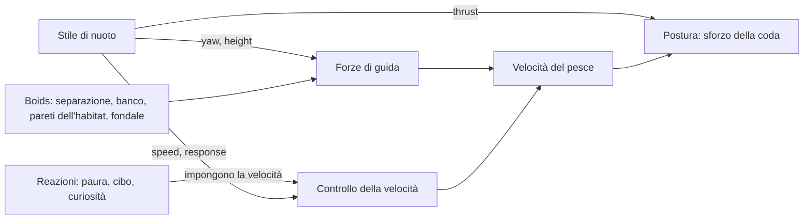

# Stili di nuoto

_English version: [SWIMMING.md](SWIMMING.md)._

In Aquaria un pesce non segue un percorso prestabilito. A ogni fotogramma lo
spingono alcune forze di guida (stare a distanza dagli altri, restare col
banco, restare nel proprio habitat, non toccare la sabbia), e il suo **stile
di nuoto** aggiunge ciò che rende riconoscibile una specie: _come_ si muove
quando niente altro richiede la sua attenzione. Un pesce chirurgo fa lunghi
giri regolari, una damigella scatta e plana, un pesce pagliaccio resta
sospeso sul posto, un pesce angelo disegna lenti otto.

Per una specie lo stile è solo un dato: lo si sceglie in
`public/species.json` e lo si regola lì. Cambiare o regolare lo stile di una
specie non richiede modifiche al codice.

## Scegliere lo stile di una specie

Aggiungere una voce `swim` alla specie in `public/species.json`:

```json
{
  "id": "three-bar-damsel",
  "swim": { "style": "burst-coast", "burstSpeed": 2, "coastSeconds": [1, 3] }
}
```

- `style` è obbligatorio e sceglie uno dei cinque stili descritti sotto.
- Tutti gli altri campi sono facoltativi: quelli assenti prendono il valore
  predefinito indicato nelle tabelle, cioè l'aspetto per cui lo stile è
  stato tarato.
- Una specie senza `swim` nuota in crociera (`{ "style": "cruise" }`).
- Il file viene validato al caricamento. Uno stile sconosciuto, un parametro
  di un altro stile o un intervallo scritto al contrario (`[3, 1]`) fermano
  l'acquario con un messaggio che indica il campo.

### Unità

Tutti i parametri sono relativi, così uno stesso stile va bene per un tetra
di 3 cm e per un barramundi di 70 cm:

| Tipo     | Unità                                                                |
| -------- | -------------------------------------------------------------------- |
| Velocità | Frazione di `speed.cruise` della specie (1 = velocità di crociera)   |
| Distanze | Lunghezze del corpo dell'individuo                                   |
| Angoli   | Radianti (π ≈ 3,14 è un'inversione a U)                              |
| Durate   | Secondi; le coppie `[min, max]` sono estratte a caso nell'intervallo |

Un pesce non supera mai la `speed.max` della sua specie, qualunque cosa
chieda lo stile.

## I cinque stili

### `cruise`: lunghi giri regolari

Pesci chirurgo, pesci in banco, nuotatori di acque libere. La direzione
vaga dolcemente, la velocità oscilla lentamente attorno a quella di
crociera (tra il 55% e il 145%) e ogni tanto il pesce si porta a una nuova
quota, da qualche parte nel suo habitat.

| Parametro             | Predefinito | Significato                                             |
| --------------------- | ----------- | ------------------------------------------------------- |
| `speedVariation`      | 0,15        | Ampiezza tipica delle variazioni di velocità            |
| `turnJitter`          | 0,5         | Quanto è irrequieta la direzione, radianti per √secondo |
| `heightChangeSeconds` | 12          | Tempo medio tra un cambio di quota e il successivo      |

### `burst-coast`: scatto, planata, rallentamento

Damigelle, guppy, platy, molti piccoli pesci di barriera. Il pesce alterna
due fasi:

1. **Scatto**: si gira verso una nuova direzione e accelera con forza, con
   la coda che batte al massimo.
2. **Planata**: la coda si ferma quasi del tutto e il pesce scivola,
   perdendo velocità per l'attrito e deviando un poco.

Ogni pesce parte da un punto a caso del ciclo, così un gruppo non scatta
mai all'unisono.

| Parametro             | Predefinito | Significato                                        |
| --------------------- | ----------- | -------------------------------------------------- |
| `burstSpeed`          | 2,2         | Velocità voluta durante lo scatto                  |
| `burstSeconds`        | 0,35        | Durata di uno scatto                               |
| `coastSpeed`          | 0,35        | Velocità verso cui rallenta durante la planata     |
| `coastSeconds`        | [1,2, 3,5]  | Durata di una planata, estratta a caso ogni volta  |
| `burstTurn`           | 0,9         | Cambio di direzione tipico a ogni scatto, radianti |
| `heightChangeSeconds` | 6           | Tempo medio tra un cambio di quota e il successivo |

### `hover`: restare sul posto

Pesci pagliaccio, gramma, gourami. Il pesce ricorda il punto in cui ha
cominciato a nuotare liberamente e ci resta: deriva piano, fa piccole
correzioni e ogni pochi secondi si gira sul posto. Se qualcosa lo ha
portato via (il cibo, uno spavento, il banco), la virata successiva lo
riporta verso casa. La quota varia di poco attorno a quella del punto.

| Parametro             | Predefinito | Significato                                            |
| --------------------- | ----------- | ------------------------------------------------------ |
| `speed`               | 0,2         | Velocità di deriva (ogni virata riparte al 70–130%)    |
| `turnSeconds`         | [1,5, 5]    | Tempo tra una virata e l'altra                         |
| `turnAngle`           | 2,2         | Virata più ampia sul posto, radianti (la minima è 0,4) |
| `roamBodyLengths`     | 4           | Quanto si allontana dal punto prima di tornare         |
| `heightChangeSeconds` | 10          | Tempo medio tra piccoli cambi di quota                 |

### `glide`: lenti otto

Pesci angelo, idoli moreschi, altri pesci alti con pinne lunghe. Il pesce
gira con regolarità da un lato per un intero anello, poi passa dolcemente a
girare dall'altro per l'anello successivo, e così via: un otto. Intanto sale
e scende attraverso il suo habitat con un'onda lunga e lenta. La coda lavora
pigramente.

| Parametro             | Predefinito | Significato                                                 |
| --------------------- | ----------- | ----------------------------------------------------------- |
| `speed`               | 0,7         | Velocità di planata                                         |
| `turnRate`            | 0,35        | Velocità di virata in ogni anello, radianti al secondo      |
| `heightSwing`         | 0,6         | Quota dell'altezza dell'habitat coperta da salita e discesa |
| `heightPeriodSeconds` | 24          | Durata di una salita e discesa                              |

La grandezza di un anello dipende da velocità e virata: raggio = velocità ÷
velocità di virata. Un pesce più lento o una virata più rapida fanno anelli
più stretti.

### `patrol`: giri attorno a una tana

Pesci territoriali: pesci farfalla, un barramundi nel suo angolo. Il pesce
sceglie un punto di casa in cui tutto il suo giro stia nell'habitat e ci
gira attorno, rientrando sul cerchio quando ne esce. Ogni tanto cambia senso
di giro. Nuota alla quota della sua casa.

| Parametro           | Predefinito | Significato                                     |
| ------------------- | ----------- | ----------------------------------------------- |
| `speed`             | 0,8         | Velocità di pattuglia                           |
| `radiusBodyLengths` | 6           | Raggio del giro; ridotto se l'habitat è stretto |
| `reverseSeconds`    | [15, 40]    | Tempo tra un cambio di senso e il successivo    |

## Cosa fanno le specie incluse

| Stile         | Specie                                                                       |
| ------------- | ---------------------------------------------------------------------------- |
| `cruise`      | pesce chirurgo blu, giallo e viola, sardina, neon, rasbora arlecchino, orata |
| `burst-coast` | damigella a tre bande, guppy, platy                                          |
| `hover`       | pesce pagliaccio, gramma reale, gourami nano                                 |
| `glide`       | idolo moresco, pesce angelo imperatore, scalare (pesce angelo d'acqua dolce) |
| `patrol`      | pesce farfalla, barramundi                                                   |

## Come funziona

### Lo stile dice solo cosa vuole il pesce

Uno stile non muove mai il pesce direttamente. A ogni passo compila una
piccola scheda, lo `SwimState` del pesce
([`src/sim/behaviors/types.ts`](../src/sim/behaviors/types.ts)):

| Campo      | Significato                                                              |
| ---------- | ------------------------------------------------------------------------ |
| `yaw`      | Direzione voluta vista dall'alto (0 = +x, π/2 = verso il vetro)          |
| `height`   | Quota voluta sopra il fondo, m                                           |
| `speed`    | Velocità voluta, frazione di quella di crociera                          |
| `response` | Quanto in fretta il pesce raggiunge quella velocità (lo scatto è rapido) |
| `thrust`   | Quanto lavora la coda: 0 ferma (planata) … 1 battito pieno               |

più alcuni contatori che lo stile tiene per sé (timer, un orologio, il senso
di giro, il punto di casa).

### La simulazione trasforma i desideri in movimento



A ogni passo, per ogni pesce ([`src/sim/simulation.ts`](../src/sim/simulation.ts)):

1. **Lo stile avanza** e aggiorna i desideri del pesce.
2. **Direzione.** Una forza gira il pesce verso `yaw`
   ([`addHeading`](../src/sim/steering.ts)). Agisce solo _di traverso_
   rispetto alla velocità, quindi gira il pesce senza accelerarlo. È questo
   che permette a un pesce in `hover` di girarsi sul posto: a bassa
   velocità la stessa spinta laterale lo fa ruotare molto più in fretta.
3. **Quota.** Una spinta verticale verso `height`, piena da 0,3 m di
   distanza. I pesci salgono e scendono comunque con dolcezza (la velocità
   verticale è limitata), quindi un cambio di quota appare come un pendio
   lento, non come un ascensore.
4. **Tutto il resto** aggiunge la sua forza come prima: separazione, banco,
   pareti morbide dell'habitat, distanza da sabbia e rocce.
5. **Velocità.** Il pesce accelera o rallenta verso `speed` con il ritmo
   `response`. Se sta reagendo a qualcosa (fugge da un tocco sul vetro, va
   verso il cibo, osserva un dito sul vetro), è la reazione a imporre il
   ritmo e la coda lavora al massimo.
6. **Postura.** Lo sforzo della coda cresce con velocità e accelerazione
   ([`tailEffort`](../src/sim/posture.ts)) ed è moltiplicato per
   `thrust`: lo scatto batte forte, la planata è ferma. Il corpo continua a
   piegarsi in ogni virata.

### Dove comincia uno stile

Un pesce già nella vasca all'apertura della scena comincia lo stile dove si
trova. Un pesce che entra da una parete laterale comincia lo stile, una
volta dentro, in un punto a caso del suo habitat: altrimenti ogni nuovo
arrivato resterebbe sospeso o farebbe la pattuglia proprio accanto alla
parete da cui è entrato.

### La stanza

Gli stili lavorano nella **stanza** del pesce: il suo habitat (fasce di
profondità e intervallo di quota) meno le pareti morbide che lo spingono
dentro. Quote e punti di casa sono sempre scelti al suo interno, così uno
stile non chiede mai a un pesce di lottare contro il proprio habitat.

### Determinismo

Tutta la casualità viene dal generatore con seme della simulazione. Lo
stesso seme dà gli stessi pesci che fanno le stesse cose: test e confronti
di immagini restano riproducibili.

## Aggiungere uno stile

1. **Dichiararne i parametri** in [`src/scene/swimming.ts`](../src/scene/swimming.ts):
   uno `z.strictObject` con il letterale `style` e un valore predefinito
   per ogni parametro, aggiunto a `swimSchema`.
2. **Scriverlo** in un file a sé in `src/sim/behaviors/`, implementando
   `SwimStyle<"tuo-id">` con due metodi:
   - `start(state, params, context)` prepara un pesce che comincia a nuotare
     liberamente (sceglie una casa, una fase, una prima quota…).
   - `step(state, params, context, deltaSeconds)` aggiorna i desideri. Gira
     per ogni pesce a 60 fps: nessuna allocazione.
3. **Registrarlo** in `SWIM_STYLES` in
   [`src/sim/behaviors/index.ts`](../src/sim/behaviors/index.ts). Il tipo
   della tabella elenca ogni id dichiarato, quindi TypeScript segnala uno
   stile dichiarato ma non registrato.
4. **Testarlo** accanto al file (`tuoStile.test.ts`). L'harness in
   [`src/sim/behaviors/harness.ts`](../src/sim/behaviors/harness.ts) fa
   girare uno stile da solo, in una stanza fissa con un generatore con seme,
   così un test può verificare per esempio che la velocità vari o che il
   pesce torni a casa.
5. **Documentarlo** qui e in [SWIMMING.md](SWIMMING.md).

Le funzioni condivise dagli stili (durate e quote casuali, oscillazione
della direzione, direzione verso un punto) sono in
[`src/sim/behaviors/shared.ts`](../src/sim/behaviors/shared.ts).
