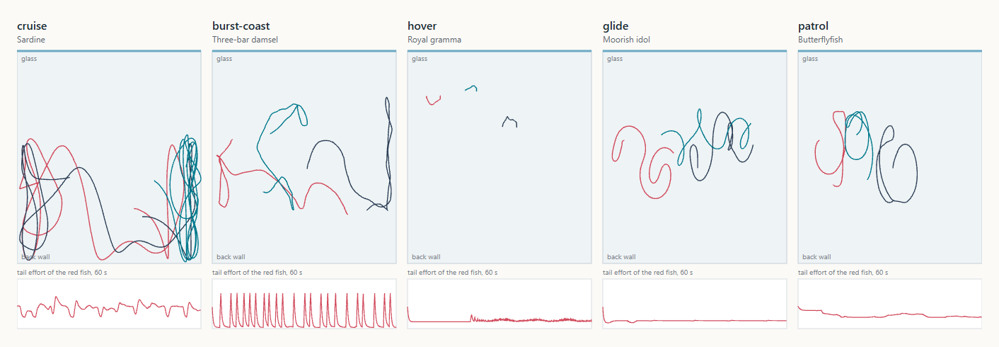
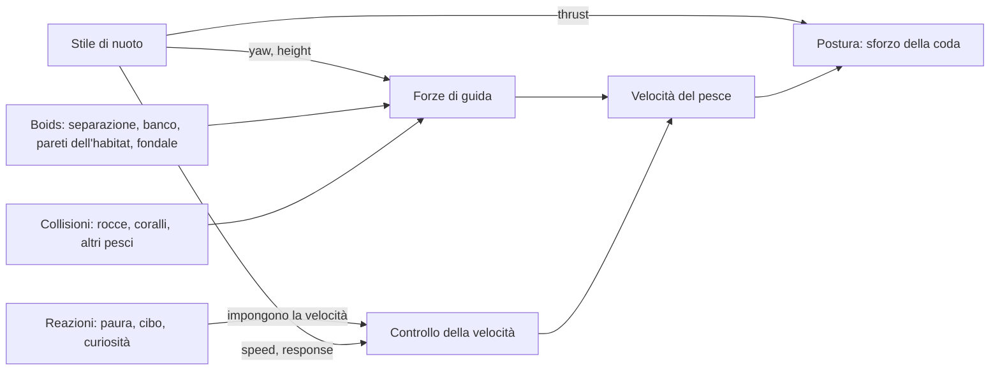

# Stili di nuoto

_English version: [SWIMMING.md](SWIMMING.md)._

In Aquaria un pesce non segue un percorso prestabilito. A ogni fotogramma lo
spingono alcune forze di guida (stare a distanza dagli altri, restare col
banco, restare nel proprio habitat, non toccare la sabbia), e il suo **stile
di nuoto** aggiunge ciò che rende riconoscibile una specie: _come_ si muove
quando niente altro richiede la sua attenzione. Un pesce chirurgo fa lunghi
giri regolari, una damigella scatta e plana, un pesce pagliaccio resta
sospeso sul posto, un pesce angelo disegna lenti otto.

Per una specie lo stile è solo un dato: lo si sceglie in
`public/species.json` e lo si regola lì. Cambiare o regolare lo stile di una
specie non richiede modifiche al codice.



<sub>Un minuto di ogni stile, visto dall'alto (vetro in alto). Sotto ogni
vasca, lo sforzo della coda del pesce rosso: costante in crociera, picchi e
quiete in burst-coast, leggero in hover e glide. Ridisegnata da
`pnpm docs:gallery` a partire dalla simulazione stessa.</sub>

## Scegliere lo stile di una specie

Aggiungere una voce `swim` alla specie in `public/species.json`:

```json
{
  "id": "three-bar-damsel",
  "swim": { "style": "burst-coast", "burstSpeed": 2, "coastSeconds": [1, 3] }
}
```

- `style` è obbligatorio e sceglie uno dei cinque stili descritti sotto.
- Tutti gli altri campi sono facoltativi: quelli assenti prendono il valore
  predefinito indicato nelle tabelle, cioè l'aspetto per cui lo stile è
  stato tarato.
- Una specie senza `swim` nuota in crociera (`{ "style": "cruise" }`).
- Il file viene validato al caricamento. Uno stile sconosciuto, un parametro
  di un altro stile o un intervallo scritto al contrario (`[3, 1]`) fermano
  l'acquario con un messaggio che indica il campo.

### Unità

Tutti i parametri sono relativi, così uno stesso stile va bene per un tetra
di 3 cm e per un barramundi di 70 cm:

| Tipo     | Unità                                                                |
| -------- | -------------------------------------------------------------------- |
| Velocità | Frazione di `speed.cruise` della specie (1 = velocità di crociera)   |
| Distanze | Lunghezze del corpo dell'individuo                                   |
| Angoli   | Radianti (π ≈ 3,14 è un'inversione a U)                              |
| Durate   | Secondi; le coppie `[min, max]` sono estratte a caso nell'intervallo |

Un pesce non supera mai la `speed.max` della sua specie, qualunque cosa
chieda lo stile.

## I cinque stili

### `cruise`: lunghi giri regolari

Pesci chirurgo, pesci in banco, nuotatori di acque libere. La direzione
vaga dolcemente, la velocità oscilla lentamente attorno a quella di
crociera (tra il 55% e il 145%) e ogni tanto il pesce si porta a una nuova
quota, da qualche parte nel suo habitat.

| Parametro             | Predefinito | Significato                                             |
| --------------------- | ----------- | ------------------------------------------------------- |
| `speedVariation`      | 0,15        | Ampiezza tipica delle variazioni di velocità            |
| `turnJitter`          | 0,5         | Quanto è irrequieta la direzione, radianti per √secondo |
| `heightChangeSeconds` | 12          | Tempo medio tra un cambio di quota e il successivo      |

### `burst-coast`: scatto, planata, rallentamento

Damigelle, guppy, platy, molti piccoli pesci di barriera. Il pesce alterna
due fasi:

1. **Scatto**: si gira verso una nuova direzione e accelera con forza, con
   la coda che batte al massimo.
2. **Planata**: la coda si ferma quasi del tutto e il pesce scivola,
   perdendo velocità per l'attrito e deviando un poco.

Ogni pesce parte da un punto a caso del ciclo, così un gruppo non scatta
mai all'unisono.

| Parametro             | Predefinito | Significato                                        |
| --------------------- | ----------- | -------------------------------------------------- |
| `burstSpeed`          | 2,2         | Velocità voluta durante lo scatto                  |
| `burstSeconds`        | 0,35        | Durata di uno scatto                               |
| `coastSpeed`          | 0,35        | Velocità verso cui rallenta durante la planata     |
| `coastSeconds`        | [1,2, 3,5]  | Durata di una planata, estratta a caso ogni volta  |
| `burstTurn`           | 0,9         | Cambio di direzione tipico a ogni scatto, radianti |
| `heightChangeSeconds` | 6           | Tempo medio tra un cambio di quota e il successivo |

### `hover`: restare sul posto

Pesci pagliaccio, gramma, gourami. Il pesce ricorda il punto in cui ha
cominciato a nuotare liberamente e ci resta: deriva piano, fa piccole
correzioni e ogni pochi secondi si gira sul posto. Appena esce dalla sua
zona torna indietro; se qualcosa lo ha portato lontano (il cibo, uno
spavento, il banco) torna a casa a velocità di crociera, scendendo o
salendo a spirale se la casa è molto più in basso o in alto. La quota varia
di poco attorno al punto.

Con `home`, il punto è invece un **luogo dello scenario**: la pianta o
l'oggetto più vicino con quel tag (vedi [Luoghi e tag](#luoghi-e-tag)). Un
pesce pagliaccio con `"home": "anemone"` resta appena sopra l'anemone più
vicino, anche quando l'anemone è più in basso del suo habitat: le sue pareti
morbide si allargano per lasciarlo lì. Se nella scena non ci sono anemoni,
resta dove ha cominciato. Quando lo scenario cambia (un anemone aggiunto o
tolto dal pannello, la finestra ridimensionata), sceglie di nuovo.

| Parametro             | Predefinito | Significato                                            |
| --------------------- | ----------- | ------------------------------------------------------ |
| `speed`               | 0,2         | Velocità di deriva (ogni virata riparte al 70–130%)    |
| `turnSeconds`         | [1,5, 5]    | Tempo tra una virata e l'altra                         |
| `turnAngle`           | 2,2         | Virata più ampia sul posto, radianti (la minima è 0,4) |
| `roamBodyLengths`     | 4           | Quanto si allontana dal punto prima di tornare         |
| `heightChangeSeconds` | 10          | Tempo medio tra piccoli cambi di quota                 |
| `home`                | nessuno     | Tag del luogo sopra cui restare, es. `anemone`         |

### `glide`: lenti otto

Pesci angelo, idoli moreschi, altri pesci alti con pinne lunghe. Il pesce
gira con regolarità da un lato per un intero anello, poi passa dolcemente a
girare dall'altro per l'anello successivo, e così via: un otto. Intanto sale
e scende attraverso il suo habitat con un'onda lunga e lenta. La coda lavora
pigramente.

| Parametro             | Predefinito | Significato                                                 |
| --------------------- | ----------- | ----------------------------------------------------------- |
| `speed`               | 0,7         | Velocità di planata                                         |
| `turnRate`            | 0,35        | Velocità di virata in ogni anello, radianti al secondo      |
| `heightSwing`         | 0,6         | Quota dell'altezza dell'habitat coperta da salita e discesa |
| `heightPeriodSeconds` | 24          | Durata di una salita e discesa                              |

La grandezza di un anello dipende da velocità e virata: raggio = velocità ÷
velocità di virata. Un pesce più lento o una virata più rapida fanno anelli
più stretti.

### `patrol`: giri attorno a una tana

Pesci territoriali: pesci farfalla, un barramundi nel suo angolo. Il pesce
sceglie un punto di casa in cui tutto il suo giro stia nell'habitat e ci
gira attorno, rientrando sul cerchio quando ne esce. Ogni tanto cambia senso
di giro. Nuota alla quota della sua casa.

| Parametro           | Predefinito | Significato                                     |
| ------------------- | ----------- | ----------------------------------------------- |
| `speed`             | 0,8         | Velocità di pattuglia                           |
| `radiusBodyLengths` | 6           | Raggio del giro; ridotto se l'habitat è stretto |
| `reverseSeconds`    | [15, 40]    | Tempo tra un cambio di senso e il successivo    |

## Cosa fanno le specie incluse

| Stile         | Specie                                                                       |
| ------------- | ---------------------------------------------------------------------------- |
| `cruise`      | pesce chirurgo blu, giallo e viola, sardina, neon, rasbora arlecchino, orata |
| `burst-coast` | damigella a tre bande, guppy, platy                                          |
| `hover`       | pesce pagliaccio, gramma reale, gourami nano                                 |
| `glide`       | idolo moresco, pesce angelo imperatore, scalare (pesce angelo d'acqua dolce) |
| `patrol`      | pesce farfalla, barramundi                                                   |

## Attività: cosa sta facendo un pesce

Lo stile dice _come_ nuota un pesce; l'**attività** dice _cosa sta
facendo_. Ogni pesce ne ha una alla volta, con una durata; quando finisce,
si estrae la successiva. Ce ne sono tre:

| Attività  | Cosa fa il pesce                                                                                                          |
| --------- | ------------------------------------------------------------------------------------------------------------------------- |
| `wander`  | Nuota col suo stile. È quella predefinita.                                                                                |
| `inspect` | Si avvicina a un luogo, gli gira attorno o resta fermo a guardarlo per qualche secondo, poi se ne va.                     |
| `peck`    | Scende in planata su un luogo e lo becchetta: si allinea poco prima, scatta a bocca aperta, indietreggia, e di nuovo.     |
| `rest`    | Nelle sue ore di riposo: si sistema accanto a un rifugio, a metà altezza, o vicino al fondo del suo habitat, quasi fermo. |

Si dichiarano nella voce `activities` della specie:

```json
"activities": {
  "wander": { "weight": 1, "seconds": [12, 30] },
  "peck": { "weight": 0.8, "tags": { "algae": 1, "plant": 0.6 } },
  "inspect": { "weight": 0.3, "tags": { "coral": 1, "starfish": 0.5 } }
}
```

- `weight`: quanto spesso si sceglie l'attività, rispetto alle altre.
  `wander` vale 1 per default, le altre 0: una specie che non dichiara
  niente vaga soltanto, esattamente come senza attività.
- `tags`: per le attività su un luogo, quanto interessa ogni tag alla
  specie, da 0 a 1 (vedi [Luoghi e tag](#luoghi-e-tag)).
- `wander.seconds`: quanto vaga un pesce prima di scegliere di nuovo.
- `inspect.seconds` (default `[4, 10]`): quanto tempo guarda;
  `inspect.distanceBodyLengths` (default 2): da quanto lontano guarda.
- `peck.pecks` (default `[3, 7]`): quante beccate prima di andarsene.
- `rest` (default peso 1, tag `{ "shelter": 1 }`, `seconds` `[40, 90]`):
  quanto e dove riposa la specie. Riposa solo nelle sue ore di riposo, e
  solo in modalità realistica (sotto).

**La scelta.** Quando un'attività finisce, ogni attività su un luogo cerca
nei paraggi (12 lunghezze del corpo, almeno 0,6 m) un luogo con un tag che
interessa la specie, preferendo i più interessanti e i più vicini. Il
luogo deve stare nelle fasce di profondità della specie; la quota non
conta, così un chirurgo che vive a mezz'acqua scende comunque a brucare le
rocce. Le attività senza un luogo adatto escono dalla scelta, e la
successiva si estrae fra le altre in base al peso, col generatore con seme.

**Al posto dello stile.** Lo stile continua a girare e l'attività ne
sostituisce i desideri: direzione, quota, velocità, coda. Può anche aprire
la bocca e scendere in picchiata a testa in giù, cosa che uno stile non fa
mai. Mentre il pesce va verso un luogo, le sue pareti morbide si allargano
attorno a quel luogo.

**Interruzioni.** Un tocco sul vetro, il cibo o un dito sul vetro
interrompono qualunque attività: il pesce torna a vagare. Lo stesso
succede se cambia lo scenario, perché il luogo potrebbe non esserci più.

**Giorno e notte (modalità realistica).** Con _Realistic_ attivo nella
sezione Fauna del pannello, i pesci seguono gli orari della loro specie.
`behavior.active` dice quando una specie è sveglia: `day` (il default),
`night` (il barramundi) o `always`. La voglia di riposare segue la luce
del ciclo diurno: 0 nelle ore attive, 1 a metà delle ore di riposo. Questo
spinge verso `rest` (dieci volte il suo peso a riposo pieno) e smorza le
altre attività, così di notte la barriera si calma mentre un cacciatore
notturno si sveglia. Fuori dalla modalità realistica nessuno dorme.

**Vederle.** Premi **A**: ogni pesce mostra la sua attività
(`wander 12s`, `peck ×3`, `inspect`), con una linea verso il luogo di cui
si occupa (vedi [Giocare con i pesci](INTERAZIONE.md#vedere-cosa-succede-a)).

Le attività stanno in `src/sim/behaviors/` accanto agli stili
(`wander.ts`, `inspect.ts`, `peck.ts`, la scelta in `choose.ts`),
registrate in `ACTIVITIES` in `activities.ts`; i loro parametri sono
dichiarati in [`src/scene/activities.ts`](../src/scene/activities.ts). Per
aggiungerne una si seguono gli stessi passi di uno stile.

## Come funziona

### Lo stile dice solo cosa vuole il pesce

Uno stile non muove mai il pesce direttamente. A ogni passo compila una
piccola scheda, lo `SwimState` del pesce
([`src/sim/behaviors/types.ts`](../src/sim/behaviors/types.ts)):

| Campo      | Significato                                                              |
| ---------- | ------------------------------------------------------------------------ |
| `yaw`      | Direzione voluta vista dall'alto (0 = +x, π/2 = verso il vetro)          |
| `height`   | Quota voluta sopra il fondo, m                                           |
| `speed`    | Velocità voluta, frazione di quella di crociera                          |
| `response` | Quanto in fretta il pesce raggiunge quella velocità (lo scatto è rapido) |
| `thrust`   | Quanto lavora la coda: 0 ferma (planata) … 1 battito pieno               |

più alcuni contatori che lo stile tiene per sé (timer, un orologio, il senso
di giro, il punto di casa).

### La simulazione trasforma i desideri in movimento



A ogni passo, per ogni pesce ([`src/sim/simulation.ts`](../src/sim/simulation.ts)):

1. **Lo stile avanza** e aggiorna i desideri del pesce.
2. **Direzione.** Una forza gira il pesce verso `yaw`
   ([`addHeading`](../src/sim/steering.ts)). Agisce solo _di traverso_
   rispetto alla velocità, quindi gira il pesce senza accelerarlo. È questo
   che permette a un pesce in `hover` di girarsi sul posto: a bassa
   velocità la stessa spinta laterale lo fa ruotare molto più in fretta.
3. **Quota.** Una spinta verticale verso `height`, piena da 0,3 m di
   distanza. I pesci salgono e scendono comunque con dolcezza (la velocità
   verticale è limitata), quindi un cambio di quota appare come un pendio
   lento, non come un ascensore.
4. **Tutto il resto** aggiunge la sua forza come prima: separazione, banco,
   pareti morbide dell'habitat, distanza da sabbia e rocce, e le
   collisioni descritte sotto.
5. **Velocità.** Il pesce accelera o rallenta verso `speed` con il ritmo
   `response`. Se sta reagendo a qualcosa (fugge da un tocco sul vetro, va
   verso il cibo, osserva un dito sul vetro), è la reazione a imporre il
   ritmo e la coda lavora al massimo.
6. **Postura.** Lo sforzo della coda cresce con velocità e accelerazione
   ([`tailEffort`](../src/sim/posture.ts)) ed è moltiplicato per
   `thrust`: lo scatto batte forte, la planata è ferma. Il corpo continua a
   piegarsi in ogni virata.

### Dove comincia uno stile

Un pesce già nella vasca all'apertura della scena comincia lo stile dove si
trova. Un pesce che entra da una parete laterale comincia lo stile, una
volta dentro, in un punto a caso del suo habitat: altrimenti ogni nuovo
arrivato resterebbe sospeso o farebbe la pattuglia proprio accanto alla
parete da cui è entrato.

### Luoghi e tag

Ogni pianta e oggetto di una scena ha dei **tag** che dicono cosa è per un
pesce. Ogni tipo ha i suoi ([`src/scene/tags.ts`](../src/scene/tags.ts)):
gli anemoni sono `anemone` e `shelter`, le rocce `rock` e `algae`, i coralli
ramificati e a tavola `coral` e `shelter`, e così via. Una voce di scena può
sostituirli con i propri `tags`, per esempio per fare di un mucchio di rocce
un nascondiglio:

```json
{ "kind": "rock", "count": 3, "color": "#7d7468", "tags": ["rock", "shelter"] }
```

Disposti nella vasca, piante e oggetti con tag diventano **luoghi**
([`src/sim/places.ts`](../src/sim/places.ts)): una posizione, l'altezza
della cima e i tag. La vista li passa alla simulazione come fa con il
fondale, e gli stili li cercano per tag: un pesce chiede "l'`anemone` più
vicino", mai un tipo, quindi basta cambiare i tag nei dati per dare a una
specie una nuova casa.

### La stanza

Gli stili lavorano nella **stanza** del pesce: il suo habitat (fasce di
profondità e intervallo di quota) meno le pareti morbide che lo spingono
dentro. Quote e punti di casa sono sempre scelti al suo interno, così uno
stile non chiede mai a un pesce di lottare contro il proprio habitat.
L'unica eccezione è una casa in un luogo (`hover` con `home`): le pareti
morbide del pesce si allargano attorno a quel luogo.

### Collisioni

I pesci girano attorno agli oggetti solidi e l'uno attorno all'altro
([`src/sim/obstacles.ts`](../src/sim/obstacles.ts),
[`src/sim/crowd.ts`](../src/sim/crowd.ts)).

- **Rocce, coralli, legni.** Ogni tipo di oggetto ha una forma di
  collisione approssimata, un ellissoide dimensionato sulla sua mesh
  (`PROP_SHAPES`; un test di render tiene allineate le due cose). Quella
  del corallo a tavola è sollevata sul gambo, così i pesci passano sotto
  il piatto. Un pesce guarda avanti lungo la rotta (0,6 s di nuoto,
  almeno 1,5 lunghezze del corpo): un oggetto lì davanti lo fa virare di
  lato, di traverso alla rotta, così scarta senza rallentare, e l'inerzia
  fa della scartata una curva. Tiene una lunghezza del corpo dagli oggetti
  che ha accanto, e una distanza rigida di 0,4 lunghezze fa scivolare
  fuori il raro pesce che ci finisce dentro lo stesso. Un pesce che
  becchetta, riposa o si nasconde in un luogo, entro quattro lunghezze dal
  luogo smette di guardare avanti e ci si accosta del tutto; lungo la
  strada aggira quello che c'è in mezzo. Le piante sono morbide: i pesci
  attraversano il kelp e si infilano negli anemoni.
- **La rockwork.** Sabbia e rockwork sono il fondale, come prima; in più
  il pesce guarda avanti se la roccia sale lungo la sua rotta e si alza in
  tempo per superare una parete.
- **Luoghi irraggiungibili.** Un luogo la cui cima sta dentro un ostacolo
  (una pianta cresciuta sotto un legno) viene escluso: nessun pesce ci
  viene mandato.
- **I rifugi sono porosi.** Un pesce spaventato che si nasconde si infila
  nel suo corallo o legno, fra i rami o sotto il piatto, quando è entro
  quattro lunghezze del corpo dal rifugio o entro la grandezza del rifugio;
  i pesci di passaggio ci girano comunque attorno.
- **Vicoli ciechi.** Un pesce che per due secondi tocca le rocce senza
  allontanarsi di una lunghezza è finito in un vicolo cieco: per due
  secondi va verso la direzione più libera intorno a sé, qualunque cosa
  voglia il suo stile.
- **Gli altri pesci.** I banchi distanziano i propri membri. In più ogni
  pesce ha uno spazio personale di mezza lunghezza del corpo: i pesci di
  altre specie che ci entrano lo spingono via, il più grande più forte,
  così è il tetra a cedere il passo allo scalare e non il contrario. Due
  corpi che si sovrappongono comunque, di qualunque specie, vengono
  separati, e il più piccolo si sposta di più.

Entrambi guardano solo ciò che è vicino: ostacoli e pesci sono smistati
in griglie di celle viste dall'alto. Con `A` acceso, `C` disegna il
contorno di ogni forma di collisione. Un nuovo tipo di oggetto ha bisogno
della sua forma in `PROP_SHAPES`.

### Determinismo

Tutta la casualità viene dal generatore con seme della simulazione. Lo
stesso seme dà gli stessi pesci che fanno le stesse cose: test e confronti
di immagini restano riproducibili.

## Aggiungere uno stile

1. **Dichiararne i parametri** in [`src/scene/swimming.ts`](../src/scene/swimming.ts):
   uno `z.strictObject` con il letterale `style` e un valore predefinito
   per ogni parametro, aggiunto a `swimSchema`.
2. **Scriverlo** in un file a sé in `src/sim/behaviors/`, implementando
   `SwimStyle<"tuo-id">` con due metodi:
   - `start(state, params, context)` prepara un pesce che comincia a nuotare
     liberamente (sceglie una casa, una fase, una prima quota…).
   - `step(state, params, context, deltaSeconds)` aggiorna i desideri. Gira
     per ogni pesce a 60 fps: nessuna allocazione.
3. **Registrarlo** in `SWIM_STYLES` in
   [`src/sim/behaviors/index.ts`](../src/sim/behaviors/index.ts). Il tipo
   della tabella elenca ogni id dichiarato, quindi TypeScript segnala uno
   stile dichiarato ma non registrato.
4. **Testarlo** accanto al file (`tuoStile.test.ts`). L'harness in
   [`src/sim/behaviors/harness.ts`](../src/sim/behaviors/harness.ts) fa
   girare uno stile da solo, in una stanza fissa con un generatore con seme,
   così un test può verificare per esempio che la velocità vari o che il
   pesce torni a casa.
5. **Documentarlo** qui e in [SWIMMING.md](SWIMMING.md).

Le funzioni condivise dagli stili (durate e quote casuali, oscillazione
della direzione, direzione verso un punto) sono in
[`src/sim/behaviors/shared.ts`](../src/sim/behaviors/shared.ts).
