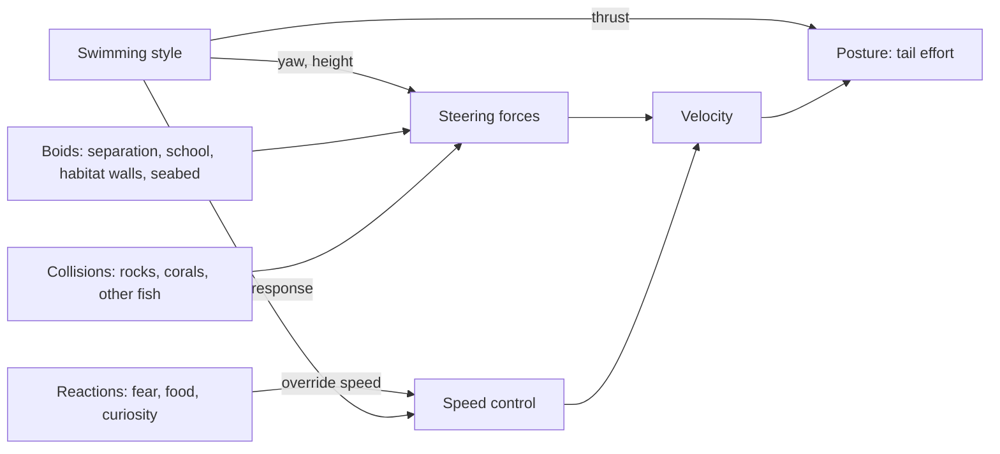

# Swimming styles

_Italian version: [NUOTO.md](NUOTO.md)._

A fish in Aquaria does not follow a scripted path. Every frame it is pushed
by a handful of steering forces (keep apart, stay with the school, stay in
the habitat, keep off the sand), and its **swimming style** adds the one
thing that makes a species recognisable: _how_ it moves when nothing else
calls for its attention. A tang cruises in long laps, a damsel darts and
glides, a clownfish hovers on the spot, an angelfish drifts in slow figure
eights.

Styles are pure data from the point of view of a species: you pick one in
`public/species.json` and tune it there. No code changes are needed to give
a species a different style, or to tune one.


<sub>A minute of each style, seen from above (glass at the top). Below each
tank, the tail effort of the red fish: steady while cruising, spikes and
stillness in burst-coast, gentle for hover and glide. Redrawn by
`pnpm docs:gallery` from the simulation itself.</sub>

## Choosing a style for a species

Add a `swim` entry to the species in `public/species.json`:

```json
{
  "id": "three-bar-damsel",
  "swim": { "style": "burst-coast", "burstSpeed": 2, "coastSeconds": [1, 3] }
}
```

- `style` is required and picks one of the five styles below.
- Every other field is optional; a missing one takes the default listed in
  the tables below, the look the style was tuned for.
- A species with no `swim` entry cruises (`{ "style": "cruise" }`).
- The file is validated when it loads. An unknown style, a parameter that
  belongs to another style, or a range written backwards (`[3, 1]`) stops
  the aquarium with a message naming the field.

### Units

All parameters are relative, so one style suits a 3 cm tetra and a 70 cm
barramundi alike:

| Kind      | Unit                                                       |
| --------- | ---------------------------------------------------------- |
| Speeds    | Share of the species' `speed.cruise` (1 = cruise speed)    |
| Distances | Body lengths of the individual                             |
| Angles    | Radians (π ≈ 3.14 is a U-turn)                             |
| Durations | Seconds; `[min, max]` pairs are drawn at random in between |

A fish never goes faster than its species' `speed.max`, whatever a style
asks for.

## The five styles

### `cruise`: long, smooth laps

Tangs, schooling fish, open-water swimmers. The heading wanders gently, the
speed drifts slowly around cruise speed (between 55% and 145% of it), and
every so often the fish settles at a new height somewhere in its habitat.

| Parameter             | Default | Meaning                                                |
| --------------------- | ------- | ------------------------------------------------------ |
| `speedVariation`      | 0.15    | Typical spread of the speed around cruise speed        |
| `turnJitter`          | 0.5     | How restless the heading is, radians per √second       |
| `heightChangeSeconds` | 12      | Average time between changes of the height it swims at |

### `burst-coast`: dart, glide, slow down

Damsels, guppies, platies, many small reef fish. The fish alternates two
phases:

1. **Burst**: it turns to a new heading and accelerates hard, tail beating
   at full strength.
2. **Coast**: the tail goes almost still and the fish glides, losing speed
   to drag, drifting a little off course.

Each fish starts at a random point of its cycle, so a group never darts in
step.

| Parameter             | Default    | Meaning                                          |
| --------------------- | ---------- | ------------------------------------------------ |
| `burstSpeed`          | 2.2        | Speed wanted in a burst                          |
| `burstSeconds`        | 0.35       | Length of a burst                                |
| `coastSpeed`          | 0.35       | Speed the fish slows towards while coasting      |
| `coastSeconds`        | [1.2, 3.5] | Length of a coast, drawn at random each time     |
| `burstTurn`           | 0.9        | Typical change of heading at each burst, radians |
| `heightChangeSeconds` | 6          | Average time between changes of height           |

### `hover`: station keeping

Clownfish, grammas, gouramis. The fish remembers the spot where it started
swimming freely and keeps station there: it drifts slowly, makes small
corrections, and every few seconds turns on the spot. As soon as it drifts
out of its spot it turns back; if something carried it far away (food, a
fright, its school) it swims home at cruise speed, circling down or up when
home is far below or above. Its height wanders a little around the spot.

With `home`, the spot is a **place in the scenery** instead: the nearest
plant or object with that tag (see [Places and tags](#places-and-tags)). A
clownfish with `"home": "anemone"` keeps station just above the nearest
anemone, even when the anemone is lower than its habitat; its soft walls
widen to let it stay there. If the scene has no anemone, it keeps station
where it started. When the scenery changes (an anemone added or removed
from the panel, the window resized), it chooses again.

| Parameter             | Default  | Meaning                                                 |
| --------------------- | -------- | ------------------------------------------------------- |
| `speed`               | 0.2      | Drifting speed (each turn sets off at 70–130% of it)    |
| `turnSeconds`         | [1.5, 5] | Time between turns                                      |
| `turnAngle`           | 2.2      | Largest turn on the spot, radians (the smallest is 0.4) |
| `roamBodyLengths`     | 4        | How far it strays from its spot before heading back     |
| `heightChangeSeconds` | 10       | Average time between small changes of height            |
| `home`                | none     | Tag of the place to keep station over, e.g. `anemone`   |

### `glide`: slow figure eights

Angelfish, moorish idols, other tall, long-finned fish. The fish turns
steadily one way through a full loop, eases into a turn the other way for
the next loop, and so on: a figure eight. At the same time it rises and
sinks through its habitat in a long, slow wave. The tail works lazily.

| Parameter             | Default | Meaning                                                  |
| --------------------- | ------- | -------------------------------------------------------- |
| `speed`               | 0.7     | Gliding speed                                            |
| `turnRate`            | 0.35    | Turn rate through each loop, radians per second          |
| `heightSwing`         | 0.6     | How much of the habitat's height one rise and fall spans |
| `heightPeriodSeconds` | 24      | Time of one rise and fall                                |

The size of a loop follows from speed and turn rate: radius = speed ÷ turn
rate. A slower fish or a faster turn makes tighter loops.

### `patrol`: laps around a home spot

Territorial fish: butterflyfish, a barramundi in its corner. The fish picks
a home spot where its whole lap fits in the habitat and circles it, steering
back onto the circle when it is off it. Now and then it changes the way
round. It swims at the height of its home.

| Parameter           | Default  | Meaning                                           |
| ------------------- | -------- | ------------------------------------------------- |
| `speed`             | 0.8      | Patrolling speed                                  |
| `radiusBodyLengths` | 6        | Radius of the lap; shrunk to fit a narrow habitat |
| `reverseSeconds`    | [15, 40] | Time between changes of direction                 |

## What the bundled species do

| Style         | Species                                                                               |
| ------------- | ------------------------------------------------------------------------------------- |
| `cruise`      | blue tang, yellow tang, purple tang, sardine, neon tetra, harlequin rasbora, seabream |
| `burst-coast` | three-bar damsel, guppy, platy                                                        |
| `hover`       | clownfish, royal gramma, dwarf gourami                                                |
| `glide`       | moorish idol, emperor angelfish, freshwater angelfish                                 |
| `patrol`      | butterflyfish, barramundi                                                             |

## Activities: what a fish is doing

A style says _how_ a fish swims; an **activity** says _what it is doing_.
Every fish has one at a time, with a duration; when it ends, the next one
is drawn. Three exist:

| Activity  | What the fish does                                                                                            |
| --------- | ------------------------------------------------------------------------------------------------------------- |
| `wander`  | Swims about in its own style. The default.                                                                    |
| `inspect` | Swims up to a place, circles it or hovers facing it for a few seconds, then swims off.                        |
| `peck`    | Dives to a place and picks at it: short darts with the mouth open, backing off in between, then off.          |
| `rest`    | In its hours of rest: settles beside a shelter, halfway up, or near the bottom of its habitat, barely moving. |

Declare them in the species' `activities` entry:

```json
"activities": {
  "wander": { "weight": 1, "seconds": [12, 30] },
  "peck": { "weight": 0.8, "tags": { "algae": 1, "plant": 0.6 } },
  "inspect": { "weight": 0.3, "tags": { "coral": 1, "starfish": 0.5 } }
}
```

- `weight`: how often the activity is chosen, relative to the others.
  `wander` defaults to 1, the others to 0, so a species that declares
  nothing only wanders and behaves exactly as without activities.
- `tags`: for activities at a place, how much each tag interests the
  species, 0 to 1 (see [Places and tags](#places-and-tags)).
- `wander.seconds`: how long a fish wanders before choosing again.
- `inspect.seconds` (default `[4, 10]`): time spent looking;
  `inspect.distanceBodyLengths` (default 2): how far from the place it
  looks from.
- `peck.pecks` (default `[3, 7]`): pecks before leaving.
- `rest` (weight 1, tags `{ "shelter": 1 }`, `seconds` `[40, 90]` by
  default): how much and where the species rests. It only rests in its
  hours of rest, and only in realistic mode (below).

**Choosing.** When an activity ends, each activity at a place looks for a
place nearby (12 body lengths, at least 0.6 m) with a tag that interests
the species, favouring the most interesting and the closest. The place
must lie in the species' depth bands; height does not matter, so a
mid-water tang still dives to graze the rocks. Activities with no such
place drop out, and the next one is drawn among the rest by weight, with
the seeded generator.

**Taking over from the style.** The style keeps running and the activity
overrides its wishes: heading, height, speed, tail. It can also open the
mouth and dive steeply, head down, which a style never does. While a fish
heads for a place, its soft walls widen around it.

**Called off.** A tap on the glass, food or a finger on the glass end any
activity: the fish goes back to wandering. So does a change of scenery,
since the place may be gone.

**Day and night (realistic mode).** With _Realistic_ on in the panel's
Fauna section, fish keep the hours of their species. `behavior.active`
says when a species is up: `day` (the default), `night` (the barramundi)
or `always`. How much it wants to rest follows the daylight of the light
cycle, from 0 in its active hours to 1 in the middle of its hours of
rest. That draws it to `rest` (ten times its weight at full restfulness)
and damps its other activities, so a reef quiets down at night while a
nocturnal hunter wakes. Outside realistic mode nobody sleeps.

**Seeing it.** Press **A**: every fish shows its activity (`wander 12s`,
`peck ×3`, `inspect`), with a line to the place it is about (see
[Playing with the fish](INTERACTION.md#seeing-what-goes-on-a)).

Activities live in `src/sim/behaviors/` next to the styles (`wander.ts`,
`inspect.ts`, `peck.ts`, the chooser in `choose.ts`), registered in
`ACTIVITIES` in `activities.ts`; their parameters are declared in
[`src/scene/activities.ts`](../src/scene/activities.ts). Adding one
follows the same steps as adding a style.

## How it works

### A style only says what the fish wants

A style never moves a fish itself. Each step it fills in a small record,
the fish's `SwimState` ([`src/sim/behaviors/types.ts`](../src/sim/behaviors/types.ts)):

| Field      | Meaning                                                          |
| ---------- | ---------------------------------------------------------------- |
| `yaw`      | Wanted heading seen from above (0 = +x, π/2 = towards the glass) |
| `height`   | Wanted height above the floor, m                                 |
| `speed`    | Wanted speed, share of cruise speed                              |
| `response` | How quickly the fish reaches that speed (a burst is fast)        |
| `thrust`   | How hard the tail works: 0 still (gliding) … 1 full beat         |

plus a few counters the style keeps for itself (timers, a clock, the way
round, the home spot).

### The simulation turns wishes into motion



Every step, for every fish ([`src/sim/simulation.ts`](../src/sim/simulation.ts)):

1. **The style steps** and updates the fish's wishes.
2. **Heading.** A force turns the fish towards `yaw`
   ([`addHeading`](../src/sim/steering.ts)). It acts _across_ the
   velocity only, so it turns the fish without speeding it up. That is
   what lets a hovering fish turn on the spot: at low speed the same
   sideways force swings it round much faster.
3. **Height.** A vertical pull towards `height`, at full strength from
   0.3 m away. Fish still climb and dive gently (their vertical speed is
   capped), so a change of height looks like a slow slope, not a lift.
4. **Everything else** adds its force as before: separation, schooling,
   the soft walls of the habitat, clearance over sand and rock, and the
   collisions below.
5. **Speed.** The fish speeds up or slows down towards `speed` at the rate
   `response`. If it is reacting to something (fleeing a tap, going for
   food, inspecting a finger on the glass), the reaction sets the pace
   instead and the tail works fully.
6. **Posture.** The tail's effort grows with speed and acceleration
   ([`tailEffort`](../src/sim/posture.ts)) and is multiplied by `thrust`,
   so a burst beats hard and a coast is still. The body still bends into
   every turn.

### Where styles start

A fish already in the tank when the scene opens starts its style where it
is. A fish that swims in through a side wall starts its style at a random
spot of its habitat once inside. Otherwise every newcomer would hover or
patrol right next to the wall it came through.

### Places and tags

Every plant and object of a scene has **tags** that say what it is to a
fish. Each kind has its own ([`src/scene/tags.ts`](../src/scene/tags.ts)):
anemones are `anemone` and `shelter`, rocks `rock` and `algae`, branch and
table corals `coral` and `shelter`, and so on. A scene entry can replace
them with its own `tags`, e.g. to make one rock pile a hiding place:

```json
{ "kind": "rock", "count": 3, "color": "#7d7468", "tags": ["rock", "shelter"] }
```

Laid out in the tank, plants and objects with tags become **places**
([`src/sim/places.ts`](../src/sim/places.ts)): a position, the height of
their top and their tags. The view hands them to the simulation the same
way as the seabed, and styles look them up by tag: a fish asks for "the
nearest `anemone`", never for a kind, so retagging data is enough to give a
species a new home.

### The room

Styles work in the fish's **room**: its habitat (depth bands and height
range) less the soft walls that push fish back inside. Heights and home
spots are always picked inside it, so a style never asks a fish to fight
its own habitat. The one exception is a home at a place (`hover` with
`home`): the fish's soft walls then widen around that place.

### Collisions

Fish swim around the solid scenery and around each other
([`src/sim/obstacles.ts`](../src/sim/obstacles.ts),
[`src/sim/crowd.ts`](../src/sim/crowd.ts)).

- **Rocks, corals, wood.** Every kind of object has a rough collision
  shape, an ellipsoid sized from its mesh (`PROP_SHAPES`; a render test
  keeps the two in step). A table coral's is raised on its stalk, so fish
  swim under the plate. A fish looks ahead along its course (0.6 s of
  swimming, at least 1.5 body lengths): an object there turns it aside,
  across its course, so it swerves without slowing, and the inertia keeps
  the swerve a curve. It keeps a body length off objects beside it, and a
  hard gap of 0.4 body lengths slides out the rare one that still dives
  in. A fish pecking, resting or hiding at a place comes right up to it.
  Plants are soft: fish swim through kelp and nestle in anemones. The
  sand and the rockwork are the seabed, as before.
- **Other fish.** Schools space their own members. Besides, every fish
  has a personal space of half a body length: fish of other species in it
  push it away, the larger pushing harder, so a tetra gives way to an
  angelfish rather than the other way round. Any two bodies that still
  overlap, of any species, are pulled apart, the smaller moving more.

Both look only at what is near: obstacles and fish are sorted into grids
of cells seen from above. With `A` on, `C` outlines every collision
shape. A new kind of object needs its shape in `PROP_SHAPES`.

### Determinism

All randomness comes from the simulation's seeded generator. The same seed
gives the same fish doing the same things, which keeps tests and visual
snapshots reproducible.

## Adding a style

1. **Declare its parameters** in [`src/scene/swimming.ts`](../src/scene/swimming.ts):
   a `z.strictObject` with a `style` literal and a default for every
   parameter, added to `swimSchema`.
2. **Write it** in a file of its own in `src/sim/behaviors/`, implementing
   `SwimStyle<"your-id">` with two methods:
   - `start(state, params, context)` sets up a fish that starts swimming
     freely (pick a home, a phase, a first height…).
   - `step(state, params, context, deltaSeconds)` updates the wishes. It
     runs for every fish at 60 fps: no allocations.
3. **Register it** in `SWIM_STYLES` in
   [`src/sim/behaviors/index.ts`](../src/sim/behaviors/index.ts). The
   table's type lists every declared id, so TypeScript reports a style
   declared but not registered.
4. **Test it** next to it (`yourStyle.test.ts`). The harness in
   [`src/sim/behaviors/harness.ts`](../src/sim/behaviors/harness.ts) runs
   a style on its own, in a fixed room with a seeded generator, so a test
   can check e.g. that the speed varies or the fish turns back home.
5. **Document it** here.

Helpers shared by styles (random durations and heights, heading jitter,
heading towards a point) are in
[`src/sim/behaviors/shared.ts`](../src/sim/behaviors/shared.ts).
