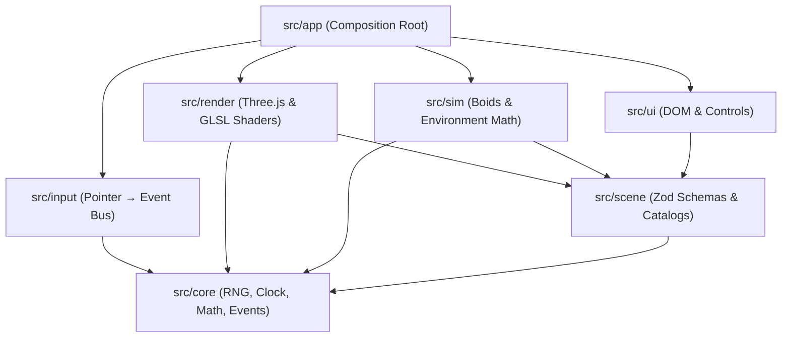

# Aquaria — User & Architectural Learning Guide

This guide covers everything needed to operate, customize, and understand the design decisions behind **Aquaria**: a browser-based, data-driven real-time 3D renderer for aquatic environments, engineered for large displays up to 4K LED walls.

---

## Table of Contents

1. [Part 1: User & Operator Guide](#part-1-user--operator-guide)
   - [Quickstart & Requirements](#quickstart--requirements)
   - [Controls & Hotkeys](#controls--hotkeys)
   - [Control Panel Overview (`H`)](#control-panel-overview-h)
   - [Lighting & Circadian Day/Night Cycle](#lighting--circadian-daynight-cycle)
   - [Quality, Resolution & Post-Processing](#quality-resolution--post-processing)
   - [The Scene Editor](#the-scene-editor)
   - [URL Launch Parameters](#url-launch-parameters)
   - [Setup for 4K LED Walls & Kiosk Mode](#setup-for-4k-led-walls--kiosk-mode)
2. [Part 2: Architectural Learning Guide ("Why It Was Built This Way")](#part-2-architectural-learning-guide-why-it-was-built-this-way)
   - [Why Web/TypeScript/Three.js instead of Unity or Unreal Engine?](#why-webtypescriptthreejs-instead-of-unity-or-unreal-engine)
   - [Downward-Only Layered Architecture](#downward-only-layered-architecture)
   - [Test-Driven Development (TDD) Without GPU/Browser Mocks](#test-driven-development-tdd-without-gpubrowser-mocks)
   - [Zero Per-Frame Allocations (The Garbage Collection Challenge)](#zero-per-frame-allocations-the-garbage-collection-challenge)
   - [Biological Steering (Boids) vs Rigid Body Physics](#biological-steering-boids-vs-rigid-body-physics)
   - [Photobiological 4-Channel LED Lighting & Fluorescence](#photobiological-4-channel-led-lighting--fluorescence)
   - [Data-Driven Architecture & Strict Zod Validation](#data-driven-architecture--strict-zod-validation)
   - [KTX2 Compressed Textures for 4K VRAM Budgets](#ktx2-compressed-textures-for-4k-vram-budgets)
   - [Modular Post-Processing Pipeline](#modular-post-processing-pipeline)

---

# Part 1: User & Operator Guide

### Quickstart & Requirements

- **Prerequisites**: Node.js (≥ 22) and `pnpm`.
- **Install dependencies & launch dev server**:
  ```bash
  pnpm install
  pnpm dev
  ```
  Open the displayed URL in your browser (typically `http://localhost:5173`).

---

### Controls & Hotkeys

| Key / Action                     | Function                  | Details                                                                                                                                                                                                                 |
| :------------------------------- | :------------------------ | :---------------------------------------------------------------------------------------------------------------------------------------------------------------------------------------------------------------------- |
| **`H`**                          | Show / Hide Control Panel | Toggles the sidebar control panel.                                                                                                                                                                                      |
| **`F`**                          | Fullscreen Toggle         | Enters or leaves borderless full-screen view.                                                                                                                                                                           |
| **`Space`**                      | Feed the Fish             | Drops a pinch of flakes, above the pointer when it is over the tank (also the feed corner button).                                                                                                                      |
| **Rest the pointer on the tank** | Finger on the Glass       | The curious individuals of each species come to look; the finger counts as gone after 8 s without movement.                                                                                                             |
| **Click the tank**               | Tap the Glass             | Nearby fish dart away; shy species flee from farther away. They calm down within a few seconds.                                                                                                                         |
| **Quick circles near a fish**    | Hypnosis                  | It stops, floats, turns and rolls with your circles; when they stop it swims off dizzy.                                                                                                                                 |
| **Scribble right over a fish**   | Tickling                  | It wriggles belly up, then darts off in a zigzag.                                                                                                                                                                       |
| **`A`**                          | What the Fish Are Doing   | Labels over every fish and a card for the one nearest the pointer. See [Playing with the fish](INTERACTION.md).                                                                                                         |
| **`C`** (with `A` on)            | Collision Shapes          | Outlines the shapes fish swim around: rocks, corals, wood.                                                                                                                                                              |
| **`T`**                          | Torch                     | The pointer shines a beam into the tank; some species gather in it, shy ones flee. Best at night.                                                                                                                       |
| **`Z`**                          | Magnifier                 | A round lens over the pointer shows the tank three times larger: look at the fish up close.                                                                                                                             |
| **`M`**                          | Sound                     | Switches the sounds on or off: the soft bubbling, a thud for taps, food, torch and magnifier. Volume in the panel's Sound section.                                                                                      |
| **`P`**                          | Point                     | On a touch screen a finger taps the glass; with Point on (or the torch or magnifier on) it points instead, and the spot stays where it is lifted.                                                                       |
| **`E`**                          | Scene Editor              | Builds rock from blocks in an isometric view (add, remove, brush size, layers, smooth preview) and sets down, moves, turns, resizes and deletes plants and objects from the palette; save. `Esc` leaves without saving. |
| **Corner buttons**               | Torch, Feed, Panel        | Appear on a mouse move or a touch, big enough for a finger, and fade again.                                                                                                                                             |
| **Mouse Move**                   | Reveal Panel Button       | A discreet corner toggle button appears for 2.5s and fades away to avoid screen burn-in.                                                                                                                                |

---

### Control Panel Overview (`H`)

Pressing **`H`** opens the control panel powered by [`createPanel`](file:///F:/progetti/Aquaria/src/ui/panel.ts#L102):

- **Scenes**: A square card with a picture of each bundled scene (_Aquaria_, _Tropical reef_, _Home reef_, _Planted tank_, _Iwagumi_), then your saved scenes; the open one is highlighted. The last card, **Editor**, opens the scene editor (also `E`).
- **About (ⓘ)**: Next to the scene's name at the top: version, author, license and a link to the code.
- **Fauna Population**: A card per species, with a live picture of the fish and a count slider; species in the tank come first. Real-time sliders for each species defined in [`species.json`](file:///F:/progetti/Aquaria/public/species.json). Increasing or decreasing numbers causes fish to swim realistically into or out of the side boundaries rather than popping into existence.
- **Scenery Elements**: One card per element, with its picture and a slider: adjust the count of corals, kelp, sea anemones, driftwood, rocks, and shells. Adding items never displaces already positioned flora or props.

#### Bundled scenes

The five bundled scenes are examples of what can be built; every one is editable in the scene editor or in its JSON file.

| Scene         | Kind of aquarium                                         |
| ------------- | -------------------------------------------------------- |
| Tropical reef | Open sea, tropical coral reef (saltwater)                |
| Home reef     | Marine reef aquarium (saltwater)                         |
| Planted tank  | Planted community aquarium (freshwater)                  |
| Iwagumi       | Iwagumi aquascape, stones and carpet plants (freshwater) |


---

### Lighting & Circadian Day/Night Cycle

Aquaria simulates a true marine aquarium lighting rig using four distinct spectral channels:

1. **White**: Broadband daylight illumination.
2. **Actinic Blue (450 nm)**: Deep penetrating blue that stimulates coral and anemone pigments.
3. **Violet / UV (420 nm)**: Triggers intense coral fluorescence.
4. **Accent & Moonlight**: Custom ambient tints and nighttime moonlight glow.

**Cycle Modes**:

- **Hour at Start** (default): Keeps the hour at which the aquarium was started, so the light matches the room and then stays still.
- **Fixed Hour**: Freezes the aquarium clock at a specific hour (0.0 to 24.0) for photography or steady ambiance.
- **Real Clock**: Synchronizes lighting with the local wall-clock time of your machine.
- **Accelerated Day**: Compresses a full 24-hour sunrise-to-night cycle into a configurable number of real minutes.

---

### Quality, Resolution & Post-Processing

Configured via the Quality section and the [`EFFECTS`](file:///F:/progetti/Aquaria/src/render/effects/index.ts#L14) registry:

- **Resolution Slider**: Render at any target height from 540p up to 4K (2160p), independent of display scaling.
- **Automatic Resolution** (on by default): when the GPU cannot keep up, the aquarium draws fewer pixels, and climbs back when there is room, so it never takes the whole GPU and stalls the screen. The slider sets the most it uses, and it never draws more pixels than the screen has; switched off, the slider's resolution is drawn as it is. The FPS counter shows the height drawn at.
- **Frame Limit**: 30 or 60 frames a second (30 by default), or none. A limit leaves the GPU free for the rest of the computer and saves battery.
- **Anti-Aliasing**: Toggle MSAA (Off, 2x, 4x, 8x) and optional SMAA for delicate geometry like grasses and fin edges.
- **Modular Effects**:
  - _Caustics_: Dynamic animated sunlight webbing across the seabed, rockwork, and swimming fish.
  - _Shadows_: Directional sunlight casting shadows from fish, rocks, and kelp.
  - _Volumetric Light_: Light shafts penetrating the water column, occluded by flora and fauna.
  - _Ambient Occlusion (SSAO)_: Contact shadows in crevasses (GPU-intensive).
  - _Depth of Field_: Optical focus falloff.
  - _Bloom & Dithering_: Soft high-luminance glow and 8-bit banding suppression on large LED surfaces.
- **GPU & FPS Monitor**: Displays real-time frame rates and warns if the browser is accidentally running on an integrated GPU.

---

### The Scene Editor

`E` (or the **Editor** card) turns the window into an isometric editing view
of the tank, without water, fish or effects:

1. **Rock from blocks**: add (`＋`) or remove (`－`) blocks with a brush of
   chosen size, slice off the top layers to work inside caves, preview the
   smoothed rock; the palette's **Rocks** tab picks the rock's material.
2. **Plants and objects**: pick one in the palette and tap the sand or a
   block to set it down, or paint it with the brush (🖌) at a chosen density;
   select one (☝) to move, turn, resize, recolor or delete it.
3. **Scene tab**: take the environment of a biome (any bundled scene), then
   tune the seed, tank size, water, murkiness, floor, backdrop, rock, light
   and current; convert an old procedural reef ridge to blocks; export,
   import or delete the scene.
4. **Undo / redo** (`Ctrl+Z`, `Ctrl+Y`), the scene's name in the bar,
   **Save** / **Save as new** (stored in this browser under _My scenes_, with
   a picture of the tank on its card) and **Exit** (`Esc`).

---

### URL Launch Parameters

Append query parameters to URL for automation and kiosk screens:

| Parameter | Example                   | Purpose                                                           |
| :-------- | :------------------------ | :---------------------------------------------------------------- |
| `scene`   | `?scene=iwagumi`          | Direct-loads a scene by its ID from `public/scenes/<id>.json`.    |
| `seed`    | `?seed=12345`             | Overrides procedural RNG seed for deterministic reproduction.     |
| `hour`    | `?hour=21.5`              | Sets the time of day (e.g. 21:30 for evening blue lighting).      |
| `effects` | `?effects=caustics,bloom` | Enables only specified effects (`?effects=none` to disable all).  |
| `frozen`  | `?frozen=10`              | Steps simulation 10 seconds and locks rendering to a still frame. |

---

### Setup for 4K LED Walls & Kiosk Mode

1. **Build and serve**:
   ```bash
   pnpm build
   pnpm preview --host
   ```
2. **Launch Chrome/Edge in Kiosk Mode**:
   ```bash
   chrome --kiosk --autoplay-policy=no-user-gesture-required http://localhost:4173
   ```
3. **Dedicated GPU Assignment (Windows)**:
   - Go to _Windows Settings → System → Display → Graphics_.
   - Add Chrome (`chrome.exe`) or Edge (`msedge.exe`) and choose **High Performance**.
   - Verify hardware acceleration is enabled in `chrome://settings/system`.

---

# Part 2: Architectural Learning Guide ("Why It Was Built This Way")

### Why Web/TypeScript/Three.js instead of Unity or Unreal Engine?

When people build high-end 3D applications, the immediate reflex is often Unity or Unreal Engine. Aquaria deliberately avoids them:

1. **Zero-Friction Kiosk Deployment**:
   - _The Reality_: Unreal/Unity standalone builds require multi-gigabyte packages, platform-specific installers, C++ runtimes, graphics driver prerequisites, and complex remote update pipelines.
   - _The Aquaria Way_: The entire production build is a lightweight bundle of static HTML/JS/CSS and KTX2 textures. Any machine with a modern browser can run it instantly over HTTP, without installation or administrative privileges.

2. **No Engine Bloat or Unpredictable GC**:
   - _The Reality_: Full game engines come with physics engines (PhysX/Chaos), audio engines, scene graphs with thousands of classes, and in Unity's case, Mono/IL2CPP C# garbage collection that can cause unexpected frame drops during long-running displays.
   - _The Aquaria Way_: Aquaria contains **only** the code needed for aquatic rendering. The engine binary footprint is negligible, boots instantly, and uses custom GLSL shaders tuned specifically for underwater visuals.

3. **Sub-Second Hot-Reload & Development Velocity**:
   - With Vite and TypeScript, editing an optical shader or a boid flocking equation reflects in the viewport in milliseconds. In Unreal or Unity, recompiling C++ or waiting for asset re-importing introduces constant friction.

4. **Transparent, Future-Proof Open Data**:
   - Everything is described in human-readable JSON files validated by Zod. There are no opaque binary scene files (`.unity`, `.umap`), making version control with Git clean and meaningful.

---

### Downward-Only Layered Architecture

The codebase enforces a strict downward dependency graph:



- **Why?**
  - If a boid in `src/sim/` depended on a Three.js `Mesh`, testing flocking behavior would require a WebGL context and GPU.
  - By restricting `src/sim/` to pure Three.js math primitives (`Vector3`, `Box3`, `Quaternion`) and banning render/DOM imports via ESLint ([`eslint.config.mjs`](file:///F:/progetti/Aquaria/eslint.config.mjs)), the simulation logic can run anywhere, including headless Node.js.
  - If Three.js is ever replaced with WebGPU / TSL, `sim`, `scene`, and `core` remain 100% untouched.

---

### Test-Driven Development (TDD) Without GPU/Browser Mocks

- **The Problem**: 3D graphical applications are notoriously hard to unit test, often leading teams to abandon automated tests and rely on manual inspection.
- **The Solution**:
  - All biological steering, rockwork generation, depth-band constraints, light curves, and population transitions are written test-first.
  - The deterministic pseudo-random generator [`src/core/rng.ts`](file:///F:/progetti/Aquaria/src/core/rng.ts) and clock [`src/core/clock.ts`](file:///F:/progetti/Aquaria/src/core/clock.ts) allow unit tests to simulate seconds or hours of aquarium evolution without race conditions.
  - All 382 unit tests pass in **under 700 ms**, enabling instantaneous feedback during development.

---

### Zero Per-Frame Allocations (The Garbage Collection Challenge)

- **The Problem**: JavaScript relies on automatic Garbage Collection (GC). If the render or simulation loop creates temporary vectors, arrays, or objects at 60 FPS across hundreds of fish:
  ```ts
  // BAD: Allocates a new object in memory every frame per fish
  const offset = new Vector3(fish.pos.x - target.x, ...);
  ```
  The browser's memory heap grows rapidly until the GC halts execution for several milliseconds ("GC stutter"). On a 4K LED wall meant to run 24/7 in an exhibition, this stutter ruins the illusion of real water.
- **The Solution**:
  - **Scratch variables**: Functions in [`src/sim/simulation.ts`](file:///F:/progetti/Aquaria/src/sim/simulation.ts) and [`src/sim/steering.ts`](file:///F:/progetti/Aquaria/src/sim/steering.ts) use static/pre-allocated scratch vectors:
  - **In-place updates**: Position arrays are mutated in place rather than reallocated.
  - **Result**: Zero heap growth in the steady-state loop, zero GC hiccups.

---

### Biological Steering (Boids) vs Rigid Body Physics

- **The Problem**: Traditional physics engines treat entities as rigid objects with collision volumes and impulses. If applied to fish, they bounce unnaturally or get stuck on obstacles.
- **The Solution**:
  - Fish navigate using Reynolds Boids algorithms modified for aquatic environments:
    1. **Separation**: Avoid crowding school mates.
    2. **Alignment**: Steer towards average flock heading.
    3. **Cohesion**: Stay near local flock center.
    4. **Depth Banding**: Restrict species to biological zones (0 = glass, 4 = back).
    5. **Seabed Clearance**: Soft upward repelling force that prevents fish from clipping sand or rocks, with a minimum body-length clearance margin.
    6. **Gaze Saccades**: Eyes lead each turn slightly before the body rotates ([`src/sim/gaze.ts`](file:///F:/progetti/Aquaria/src/sim/gaze.ts)).
    7. **Reactions**, in order of urgency: fear of a tap on the glass, hunger for food flakes ([`src/sim/food.ts`](file:///F:/progetti/Aquaria/src/sim/food.ts)), curiosity about a finger on the glass. Each species tunes them with `behavior.appetite`, `curiosity` and `shyness` in `species.json`.
    8. **Swimming styles**: when nothing calls for its attention, each species swims its own way (`cruise`, `burst-coast`, `hover`, `glide`, `patrol`), picked and tuned with `swim` in `species.json`. See [Swimming styles](SWIMMING.md).
  - **A procedural rig instead of a skeleton**: the simulation computes a few "joint" values per fish and the shader deforms the body with them ([`src/sim/posture.ts`](file:///F:/progetti/Aquaria/src/sim/posture.ts)): `bend` lays the rear of the body along the arc the fish swims (path curvature times body length, up to a C-shaped escape), `effort` scales the tail sweep with speed and acceleration, `mouth` drops the jaw before a bite. When glTF fish arrive, the same channels will drive their animations.

---

### Photobiological 4-Channel LED Lighting & Fluorescence

- **The Problem**: Standard computer graphics light models (point/directional lights with a single color) look flat and artificial when rendering aquatic environments.
- **The Solution**:
  - Aquaria models reef-aquarium science: corals contain green/red fluorescent proteins (GFP/RFP) that absorb ultraviolet and blue photons and re-emit them as visible glow.
  - Custom GLSL material patches ([`src/render/shaders/fluorescencePatch.ts`](file:///F:/progetti/Aquaria/src/render/shaders/fluorescencePatch.ts)) compute the intensity of actinic blue and violet light reaching each coral surface, adding an emissive fluorescent glow to the rendered fragment.
  - The daylight cycle raises the blue spectrum earlier than white at dawn, and lowers white before blue at dusk, replicating real tropical reefs.

---

### Data-Driven Architecture & Strict Zod Validation

- **The Problem**: Hardcoded configurations require code changes and recompilation for every visual tweak. On the other hand, unvalidated JSON leads to cryptic runtime crashes in shaders or physics.
- **The Solution**:
  - All scenes ([`public/scenes/`](file:///F:/progetti/Aquaria/public/scenes/)) and species ([`public/species.json`](file:///F:/progetti/Aquaria/public/species.json)) are declarative JSON.
  - Validated at the boundary using [Zod](https://zod.dev) in [`src/scene/schema.ts`](file:///F:/progetti/Aquaria/src/scene/schema.ts).
  - Any error (out-of-range depth band, missing texture ID, invalid hex color) produces an immediate, user-friendly error pinpointing the exact field before rendering begins.

---

### KTX2 Compressed Textures for 4K VRAM Budgets

- **The Problem**: Standard PNG or WebP images decompress into raw uncompressed RGBA in GPU memory (VRAM). A single 4K normal map + surface map can consume over 60 MB of VRAM. With multiple materials, GPU memory is quickly exhausted, leading to frame drops.
- **The Solution**:
  - Aquaria textures use KTX2 with Basis Universal / UASTC compression.
  - KTX2 files remain compressed _inside the GPU VRAM_ and are decoded on-the-fly by the GPU hardware texture units.
  - This reduces VRAM consumption by ~75%, allowing rich 4K surfaces to run smoothly even on mid-range hardware.

---

### Modular Post-Processing Pipeline

- **The Problem**: Traditional post-processing chains are monolithic; adding or tweaking a pass requires editing central composite shaders.
- **The Solution**:
  - Post-processing effects are encapsulated modules implementing [`EffectDefinition`](file:///F:/progetti/Aquaria/src/render/effects/types.ts).
  - Each effect declares its stage (HDR before tonemapping, or Display after tonemapping), its UI controls, and its defaults.
  - Registered in [`src/render/effects/index.ts`](file:///F:/progetti/Aquaria/src/render/effects/index.ts#L14):
    ```ts
    export const EFFECTS = [
      ambientOcclusionEffect,
      volumetricLightEffect,
      depthOfFieldEffect,
      bloomEffect,
      smaaEffect,
      finishEffect,
    ];
    ```
  - Adding a new shader effect requires only creating a single file in `src/render/effects/` and adding it to this array.
